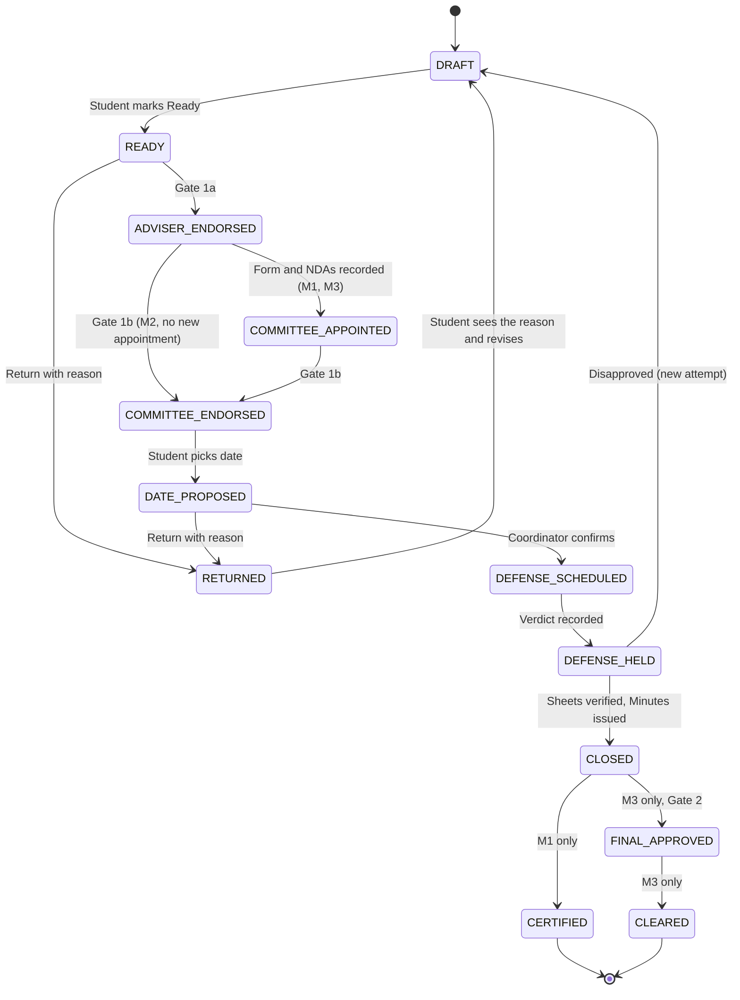
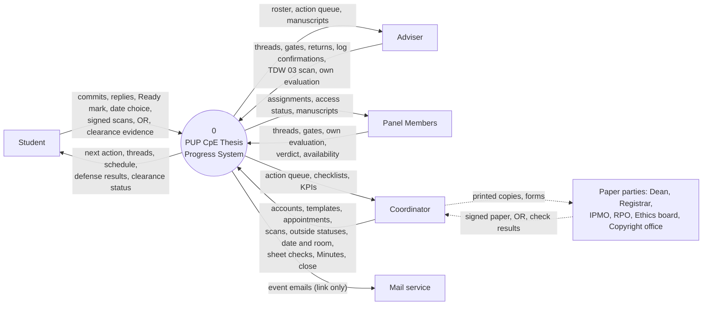
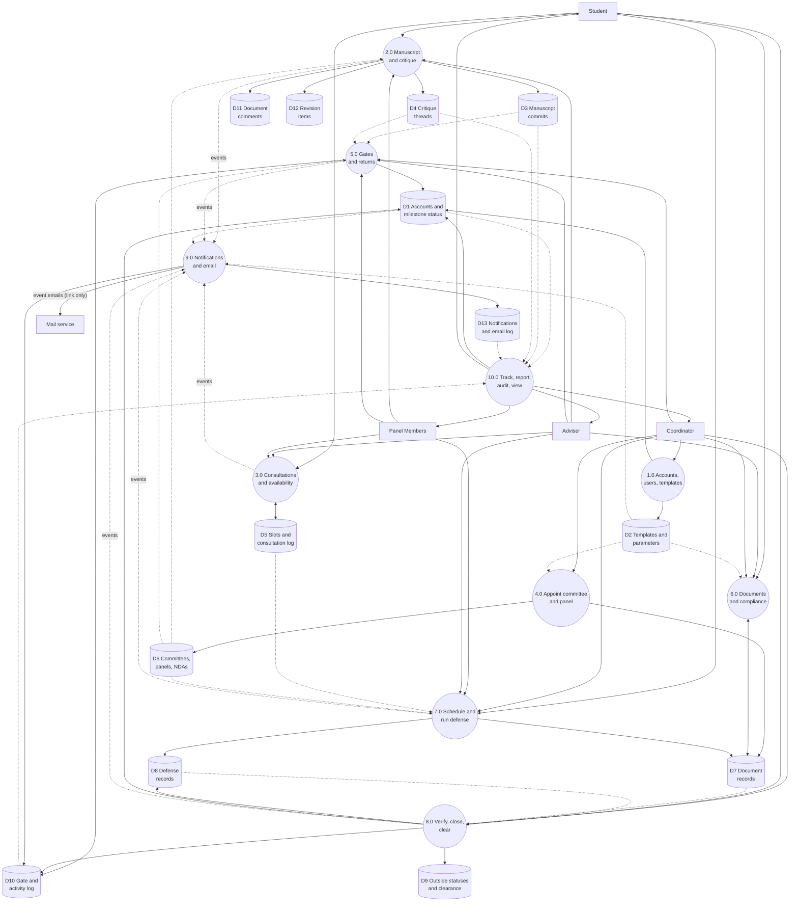
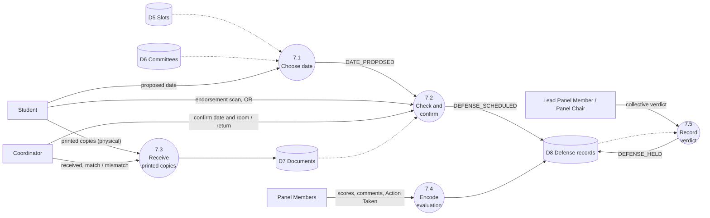
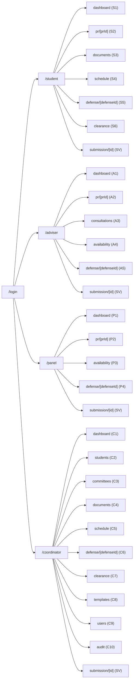

# PUP CpE Thesis Progress System — Operational Flow, DFD and Sitemap (v3.1)

**Compliance standard:** Simplified Technical English (ASD-STE100) at about 80%
**Scope:** PUP CpE Graduate Program — Master's and Doctoral
**Source of truth:** *Unified Thesis Process, Screens and Sitemap* v1.1 (22 Nov 2026)
**Companion file:** `PUP_CpE_Thesis_Progress_System_Functional_Requirements_v1.1.md` (FR, BR and AS IDs)
**Status:** Replaces the Operational Flow, the early Sitemap and the flow parts of the Architectural Scratchpad. The older files stay unchanged as history.
**Update (17 Nov 2026), v3:** Adds the decisions made after v2: "Evaluator" renamed "Panel Member"; one role per account; three comment contexts; Defense Day threads at the Final Defense; shared submission view; email and in-app notifications; consultation meeting link; 30 routes; DFD processes 9.0 and 10.0 and stores D11 to D13. v2 stays unchanged as history.
**Update (22 Nov 2026), v3.1:** Source of truth set to Unified v1.1. Companion file set to Functional Requirements v1.1. Owner decision added: RETURNED goes back to DRAFT. The Student sees the written reason. v3 stays unchanged as history.
**Rule for this file:** The rules come from the Unified Doc and from the decisions listed in the Functional Requirements file. The DFD (Part 3) is a derived view. It shows the same rules as data flows.

---

## 0. What changed (de-staling summary)

### 0.1 Old content that is now replaced

| Old content | Where | Replaced by |
| :---- | :---- | :---- |
| 7-stage flow (Stage 0 to Stage 6) | Operational Flow | 3 milestones plus clearance (Part 2) |
| Stage 0 inside the system, Student uploads documents | Operational Flow, Alignment Report | Stage 0 is outside the system. The Coordinator creates the account after eligibility. |
| Gate 1 by the Adviser alone | ADR-002 | Gate 1a (Adviser). Gate 1b (Adviser and every Panel Member). |
| Committee assigned at setup | Operational Flow | Appointed after Gate 1a (late binding) |
| Panel read access opens at Gate 1 | ADR-002 | Opens when the appointment form and that member's NDA are recorded |
| Defense-day unlock of rubric forms only | ADR-002 | Defense Day page opens at the scheduled start. Each member encodes their own evaluation. |
| Scheduling parked (GAP-02) | ADR-005 | The Student picks a date. The Coordinator confirms date and room. |
| Physical evaluation parked (GAP-03) | ADR-006 | Members encode. The Coordinator uploads scans and checks them against the encoded entry. |
| Verdict actor unknown (GAP-01, GAP-04) | Gap matrix | Lead Panel Member (Proposal, Pre-Final). Panel Chair (Final). |
| Gate 2 unclear | GAP-04 | Gate 2 exists in Milestone 3 only. Proposal uses a Certification. |
| Final archiving missing (GAP-05) | Gap matrix | Clearance steps (Section 2.8) |
| Verdicts: Pass / Conditional Pass / Re-Defense, or Pass / Minor / Major / Fail | Operational Flow, Alignment Report | Approved / Approved with Revisions / Disapproved |
| 4 roles, 4 portals, about 13 routes | Scratchpad Sitemap | 4 roles (2 designations), 4 portals, 30 routes (Part 4) |
| 5-year residency as a hard rule | Alignment Report | Warning only. Values are unverified. |
| Post-defense critique threads by the panel (Stage 6) | Operational Flow | Defense Day threads at the Final Defense only (Section 2.10) |
| Email notification as an open item (FR-SYS-03) | Scratchpad | Event emails and an in-app notification center (Section 2.11) |

### 0.2 Status of earlier decision records (ADRs)

| ADR | Topic | Status in v3 |
| :---- | :---- | :---- |
| ADR-001 | Disjoint Adviser / Panel roles | **Kept.** One role per account. An Adviser is never a Panel Member. The Adviser keeps the committee powers for that Student. |
| ADR-002 | Two-stage gatekeeping | **Replaced** by the gate model in Section 2.7 |
| ADR-003 | PR-style ordinal commits and threads | **Kept.** Changes: each reviewer resolves their own threads. Panel Members post threads at committee review and at the Final Defense (Section 2.10). |
| ADR-004 | One Student, one Thesis Instance | **Kept** |
| ADR-005 | Defense scheduling | **Resolved** by default answer G6/G17 |
| ADR-006 | Physical evaluation bridge | **Resolved.** See Section 2.5, steps 12 to 14. |
| ADR-007 | AI deferral, frontend-first | **Kept.** The Unified Doc has no AI features. No AI is in this file. |
| ADR-008 | Non-blocking commits | **Changed.** Commits stay open until Gate 1b. The manuscript then locks until the defense closes. |
| ADR-009 | PR-level (not PDF-pinned) threads | **Not addressed** in the Unified Doc. Carry over. |
| ADR-010 | Persona Switcher and parked actions in Coordinator portal | **Needs update.** The Coordinator portal now holds real screens (C1 to C10). The persona switcher is not in the Unified Doc. |

---

## 1. Glossary (updated)

| Term | Definition |
| :---- | :---- |
| **Student** | The candidate. Owns one Thesis Instance. |
| **Adviser** | Faculty member. A committee member for that Student. Never a Panel Member. |
| **Panel Member** | Faculty member on the Evaluation Committee (2 for Master's, 3 for Doctoral) or on the Final Panel (3 for Master's, 4 for Doctoral, besides the Chair). Never an Adviser. |
| **Lead Panel Member** | A designation. One Panel Member named by the Coordinator. Records the verdict at Proposal and Pre-Final. |
| **Panel Chair** | A designation. The Panel Member named as Chair on TDW 11. Completes a TDW 13 sheet. Records the verdict at Final. |
| **Coordinator** | One role: Program Chair and Graduate School Secretary. The only role that closes a stage. Never an Adviser or Panel Member. |
| **Dean** | Not a system user. Signs forms on paper. The Coordinator records the signatures. |
| **Evaluation Committee** | Adviser plus 2 Panel Members (Master's) or 3 Panel Members (Doctoral). Used at Proposal and Pre-Final. |
| **Final Defense Panel** | Chair plus 3 Members (Master's) or 4 Members (Doctoral). Used at Final. |
| **Milestone Template** | Metadata: required items, forms, parameters for one milestone. |
| **Milestone Instance** | One Student's record against one Milestone Template. |
| **Submission PR** | The versioned container for manuscript commits and critique threads. |
| **Commit** | An ordinal file upload (v1, v2, v3 ...). |
| **Critique Thread** | Feedback tied to one commit. Written by a reviewer. Only that reviewer resolves it. |
| **Ready mark** | The Student marks one commit for review. A new commit clears it. |
| **Outdated** | Badge on an open thread when a newer commit exists. |
| **OR** | Official Receipt from the registrar. Proof of the defense payment. |
| **Two-layer approval** | An in-system action is **intent**. The wet-signed paper is the **record**. |
| **Outside status** | Status of ethics, IPMO, RPO or copyright. The Coordinator sets it. The system only shows it. |
| **Defense Day thread** | A thread a Panel Member posts at the Final Defense. It runs from the scheduled start until Gate 2. |
| **Revision item** | One recommendation from the Minutes (Proposal and Pre-Final). It tracks one revision to a commit. |
| **Meeting link** | The link on an Online consultation slot. Only the Adviser and the booked Student see it. |
| **Notification** | An in-app event. Most events also send an email. The email gives a link only. |

---

## 2. Operational Flow

### 2.1 System boundary

| Inside the system | Outside the system |
| :---- | :---- |
| Milestones 1 to 3 and clearance | Stage 0: concept paper, Adviser appointment, units, comprehensive exam, enrollment |
| Manuscript commits and critique threads | Ethics review (status only) |
| Consultation log, scheduling and meeting links | IPMO check, RPO editing, copyright registration (status only) |
| Forms checklist, scans and paper match | IDSA statistician, questionnaire editing, translation |
| Defense Day evaluation entry, verdicts and event emails | Subject grade, e-signatures, news and announcements |

The system is a coordination layer. The signed paper stays the official record.

### 2.2 Stage 0: Account creation (Coordinator, outside the Student's view)

| Step | Actor | Action |
| :---- | :---- | :---- |
| 1 | Coordinator | Confirms the Student is eligible (done outside the system). |
| 2 | Coordinator | Creates the Student account (screen C2). Enters name, degree level, program start term, comprehensive exam date, Writing 1 enrollment (RSH 641 or RSH 741) and Adviser. |
| 3 | System | Creates one Thesis Instance and Milestone 1. |

The Student uploads no Stage 0 document.

### 2.3 Roles and committee size

| Group | Master's | Doctoral |
| :---- | :---- | :---- |
| Evaluation Committee (Proposal, Pre-Final) | Adviser + 2 Panel Members | Adviser + 3 Panel Members |
| Evaluation sheets at Proposal and Pre-Final | 3 | 4 |
| Final Defense Panel | Chair + 3 Members | Chair + 4 Members |
| Evaluation sheets at Final (TDW 13) | 4 | 5 |
| Printed proposal copies | 5 | 6 |

### 2.4 Milestone overview

| Milestone | Official phase | Key forms | Ends when |
| :---- | :---- | :---- | :---- |
| **1. Proposal Defense** | Writing 1 (RSH 641 / 741) | TDW 03, 05, 06, 07, 08 | CERTIFIED, and the Adviser approves data gathering |
| **2. Pre-Final Defense** | Writing 2, first defense | TDW 03, 09, 10 | CLOSED |
| **3. Final Defense and Clearance** | Writing 2, second defense and clearance | TDW 03, 11, 12, 13 | CLEARED |

Entry rules:
- Milestone 2 opens when Milestone 1 is CERTIFIED and the Adviser approves data gathering.
- Milestone 3 opens when Milestone 2 is CLOSED.

### 2.5 Common defense cycle (14 steps, all three milestones)

| No. | Step | Actor | Rule |
| :---- | :---- | :---- | :---- |
| 1 | Write and consult | Student, Adviser | Student uploads commits. The Student can list an agenda and link threads before a slot. An Online slot shows a meeting link. The system drafts a log entry when the Adviser confirms a booked slot. The Student adds the topic. The Adviser confirms. No minimum count. |
| 2 | Review and reply | Adviser, Student | This is the Adviser and Student iteration (Section 2.10, context A). Threads are bound to a commit. A new commit marks older open threads Outdated. Each reviewer resolves their own threads. |
| 3 | Mark Ready | Student | Student marks one commit. A new commit clears the mark. |
| 4 | **Gate 1a** | Adviser | Endorse for committee review, or Return with a reason. The Adviser's own threads must be resolved. |
| 5 | Appoint committee or panel | Coordinator (Dean assigns on paper) | Record the appointment form and NDAs. Upload scans. A member reads the manuscript only after the form and that member's NDA are recorded. A member who declines gets a replacement. |
| 6 | Committee review | Panel Members, Student | Panel Members read, post threads and reply. Student answers and uploads commits. |
| 7 | **Gate 1b** | Adviser, each Panel Member | Each member's own threads must be resolved. All members must endorse. The manuscript **locks**. |
| 8 | Choose a date | Student | The calendar shows dates when all required members are free. It blocks dates less than 7 days after Gate 1b. |
| 9 | Prepare endorsement form | Student | The system fills the form with the date. The Student collects signatures: committee, Program Chair (noted), Dean (approved). The Student scans it and uploads it with the OR. The scan is provisional. |
| 10 | Check and confirm | Coordinator | Run the compliance check. Confirm date and room, or Return with a written reason. |
| 11 | Hand in printed copies | Student, Coordinator | Due at least 7 days before the defense. The Coordinator matches them against the locked manuscript. |
| 12 | Defense Day | Each member | The page opens at the scheduled start. Each member encodes their own evaluation and signs the paper sheet. At the Final Defense, Panel Members can also post threads from the start (Section 2.10, context C). |
| 13 | Record the verdict | Lead Panel Member or Panel Chair | Allowed on or after the defense date. The verdict is collective. The system warns if a member's Action Taken differs. |
| 14 | Verify and close | Coordinator | Upload every sheet scan. Check each against its encoded entry. Check printed documents against locked files. Issue the Minutes. Close the defense. The manuscript unlocks. |

### 2.6 What changes in each milestone

| Item | Milestone 1: Proposal | Milestone 2: Pre-Final | Milestone 3: Final |
| :---- | :---- | :---- | :---- |
| Manuscript | Chapters 1 to 3 | Chapters 1 to 5 | Revised full manuscript |
| Consultation log | TDW 03 (Proposal phase). Adviser uploads. | TDW 03 (Pre-Final phase) | TDW 03 (Final phase) |
| Extra condition, Gate 1a | None | IPMO status PASSED | None |
| Appointment | Evaluation Committee: TDW 06, NDA (TDW 05) | None. NDA carries over. | Final Panel: TDW 11, new NDA |
| Outside status before date confirmation | Ethics APPROVED | None | None |
| Extra at Gate 1b | None | None | Each member marks Pre-Final revisions as accepted |
| Endorsement form | TDW 07 (ethics certification attached) | TDW 09 (printed manuscript, Proposal Minutes, IPMO result attached) | TDW 12 (final manuscript, Pre-Final Minutes attached) |
| Compliance check | TDW 03, TDW 06 + NDAs, TDW 07 scan, ethics APPROVED, OR verified | TDW 03, TDW 09 scan, IPMO PASSED, OR verified | TDW 03, TDW 11 + NDAs, TDW 12 scan, OR verified |
| Evaluation form | TDW 08. One sheet per committee member (Adviser included). | TDW 10. One sheet per committee member (Adviser included). No scores. | TDW 13. One sheet per Panel Member of the Final Panel. Adviser completes none. |
| Verdict recorded by | Lead Panel Member | Lead Panel Member | Panel Chair |
| Minutes | Proposal Defense | Pre-Final Defense | Final Defense |
| After the defense | Revise. The Coordinator lists revision items from the Minutes. Each committee member accepts the items and signs the Certification of Proposal Approval. Coordinator records CERTIFIED. Adviser approves data gathering. | Revise. The Coordinator lists revision items from the Minutes. Adviser and committee check them in Milestone 3. No Certification. | Revise using the Defense Day threads (Section 2.10). No revision items. Then clearance (Section 2.8). |
| Printed copies | 5 (Master's) or 6 (Doctoral) | Count to confirm | Count to confirm |

### 2.7 Gates and status model

**Gates**

| Gate | Who | Needs | Result |
| :---- | :---- | :---- | :---- |
| Gate 1a | Adviser | Own threads resolved. In Milestone 2: IPMO PASSED. | Committee or panel can be appointed |
| Gate 1b | Adviser + every Panel Member | Each member's own threads resolved. In Milestone 3: Pre-Final revisions accepted. | Manuscript locks. Student can pick a date. |
| Date confirmation | Coordinator | Milestone compliance check | DEFENSE_SCHEDULED |
| Verdict | Lead Panel Member or Panel Chair | Defense date has arrived | DEFENSE_HELD |
| Stage close | Coordinator | Every sheet verified. Minutes issued. | CLOSED |
| Certification (Milestone 1) | Each committee member | Revision items accepted | CERTIFIED |
| Gate 2 (Milestone 3) | Committee + Final Panel | IPMO PASSED, RPO DONE, the member's own threads resolved | FINAL_APPROVED |
| Clearance close | Coordinator | Every clearance item verified | CLEARED |

**Milestone status flow**

Notes:
- A new Disapproved attempt restarts at cycle step 2. The system keeps every attempt in the history.
- RETURNED has a written reason. A Coordinator Return is for compliance or eligibility only.
- RETURNED goes back to DRAFT. The Student sees the written reason. (Owner decision, 22 Nov 2026.)
- Only the Coordinator sets CLOSED, CERTIFIED, FINAL_APPROVED and CLEARED.

**Document lifecycle**

| State | Meaning |
| :---- | :---- |
| Not started | No file yet |
| Prepared | The system filled the form with known data (for example, the date) |
| Scan uploaded | Provisional. The uploader can replace it. |
| Locked as submitted | The file cannot change silently |
| Physical received | The Coordinator received the paper |
| Verified | The paper matches the locked file |
| Mismatch | The paper differs. The author corrects it. **The defense is not stopped.** The stage cannot close until the file is corrected and verified. |
| Returned | A reviewer sent it back with a written reason |

**Outside statuses (set by the Coordinator)**

| Field | Used in | Values |
| :---- | :---- | :---- |
| Ethics | Milestone 1 | NOT_SUBMITTED, UNDER_REVIEW, CHANGES_REQUIRED, APPROVED |
| IPMO similarity check | Milestones 2 and 3 | NOT_SUBMITTED, UNDER_CHECK, FAILED, PASSED |
| RPO editing | Milestone 3 | NOT_SUBMITTED, UNDER_EDITING, DONE |
| Copyright | Milestone 3 | NOT_APPLIED, APPLIED, REGISTERED |

### 2.8 Defense outcomes, substitutes and clearance

**Outcomes**

| Collective verdict | Defense status | Next |
| :---- | :---- | :---- |
| Approved | CLOSED | Proposal: Certification is signed. Pre-Final: Milestone 3 opens. Final: clearance starts. |
| Approved with Revisions | CLOSED | The manuscript unlocks. The Student revises. Revisions are checked as in Section 2.6. At the Final Defense, the threads track them. |
| Disapproved | Stays open | The Student revises. The cycle restarts at step 2. A new attempt starts. |

**Substitute panelist**
1. The Coordinator records the substitute before the defense.
2. The substitute signs the NDA and gets read access to the locked manuscript.
3. The substitute completes the absent member's sheet on the Defense Day page.
4. The Graduate School decides if TDW 06 or TDW 11 needs a paper amendment (question PK2).

**Clearance after the Final Defense**

| No. | Step | Actor | Rule |
| :---- | :---- | :---- | :---- |
| 1 | Revise using the Defense Day threads and the Minutes | Student, Adviser, Panel Members | Manuscript unlocks. The Student replies and uploads new commits. Each Panel Member resolves their own threads. Skipped if the verdict is Approved without revisions. |
| 2 | Similarity check, then IPMO (outside) | Student, Adviser | Coordinator sets IPMO status. FAILED means resubmit. |
| 3 | RPO editing (outside). Revise after editing. | Coordinator, Student, Adviser | Coordinator sets RPO status. |
| 4 | **Gate 2** | Committee, Final Panel, Coordinator | Each member marks the final manuscript approved. All sign the approval sheet on paper. The Dean signs. The Coordinator records it. Needs IPMO PASSED, RPO DONE and no open threads for that member. Result: FINAL_APPROVED. |
| 5 | Copyright application (outside) | Student, Coordinator | Coordinator sets copyright status. |
| 6 | Final copy to the Coordinator | Student, Coordinator | Coordinator records receipt and checks it against the approved manuscript. |
| 7 | Upload conference presentation certification | Student | Coordinator verifies. |
| 8 | Upload journal publication copy or acceptance | Student | Coordinator verifies. |
| 9 | Close the milestone | Coordinator | Every item verified. The system shows the Certificate of Compliance checklist. Result: CLEARED. |

Steps 5 to 8 can happen in any order.

### 2.9 Evaluation fields (Defense Day page)

**TDW 08 and TDW 13 (rubric)**

| Indicator | Weight |
| :---- | :---- |
| A1 Contribution to the field | 10% |
| A2 Substance and content | 20% |
| A3 Methodology | 20% |
| A4 Form and writing style | 10% |
| B1 Organization | 10% |
| B2 Delivery and oral articulation | 10% |
| B3 Mastery of the topic | 20% |
| **Total** | **100%** |

Each sheet also has a comments box and Action Taken (Approved, Approved with Revisions, Disapproved). The system adds the total. It does not show the grade equivalent.

**TDW 10 (no scores):** comments for Title and Preliminaries; one box per chapter (1 to 5); Partial References and Appendices; Remarks; General observations; Action Taken.

### 2.10 Comment contexts

| Context | Who | Window | Screens | Resolve |
| :---- | :---- | :---- | :---- | :---- |
| **A. Iteration** | Adviser, Student | Before Gate 1a. Also after a Return. | S2, A2. Consultation notes in S4, A3. | The Adviser resolves their own threads. The Student replies. |
| **B. Committee review** (Milestones 1 and 2) | Panel Members, Student | After the appointment. Before Gate 1b. | P2, S2 | Each Panel Member resolves their own threads. |
| **C. Defense Day** (Milestone 3) | Panel Chair, Panel Members, Student | From the scheduled start of the Final Defense until Gate 2 | P4 tab "Manuscript and comments", P2, S2 | Each Panel Member resolves their own threads after checking a new commit. |

Rules:
- Panel Members are appointed after Gate 1a. They cannot comment in context A.
- In context C, the Student sees the threads when the defense closes and the manuscript unlocks. Gate 2 is blocked while a member has open threads.
- A newer commit marks older open threads Outdated. They stay OPEN.
- Revision items (from the Minutes) track revisions at Proposal and Pre-Final only. At the Final, the threads are the tracker.
- In Milestones 1 and 2, a Panel Member can also comment on a form scan or a supporting file (FR-REV-11).
- In context A, the Student can add a change note to a commit and tag the threads it addresses. The tag does not change the thread state.

### 2.11 Notifications and email

The system records an in-app notification for each event. Most events also send an email. The full list is in the Functional Requirements file (FR-NTF-01 to FR-NTF-10).

| Category | Use cases | Examples |
| :---- | :---- | :---- |
| A. Defense schedule | 6 | Date proposed, date confirmed, date returned, reminders (3 days and 1 day), results available |
| B. Deadlines and tasks | 7 | Printed copies due, target date near, document returned, revision item waiting, residency warning |
| C. Threads and comments | 6 | Commit Ready, new thread, reply, thread resolved, gate done |
| E. Account and access | 3 | Account created, manuscript access opened, committee appointed |
| F. Consultations | 2 | Request received, request confirmed or declined |
| **Total** | **24** | |

Rules:
- An email holds the event, the next action, the deadline and a link. It holds no manuscript text, comments, scores, verdicts or meeting links.
- The link opens the app. Sign-in is required.
- Thread and comment events group into one email per commit per day. Reminders group into one daily email. One daily job sends them (free-tier limit).
- A user can turn off reminders and digests. Other emails stay on.
- A failed email never blocks a step. The in-app event is still recorded.
- News and announcements are deferred.

---

## 3. Data Flow Diagrams (derived view)

Notation: rectangles are external entities. Circles and rounded boxes are processes. Cylinders are data stores. The Dean, the registrar and the outside offices work on paper. Their data enters through the Coordinator or the Student.

### 3.1 External entities

| Entity | Sends to the system | Receives from the system |
| :---- | :---- | :---- |
| Student | Commits, replies, Ready mark, consultation requests, date choice, signed scans, OR, printed copies (physical), clearance evidence | Next-action card, threads, schedule, defense results, Minutes, clearance status |
| Adviser | Threads, Gate 1a/1b/2 actions, returns, log confirmations, TDW 03 scan, availability, own evaluation, data-gathering approval | Advisee roster, action queue, manuscripts, defense schedule |
| Panel Member | Threads, Gate 1b/2 actions, availability, own evaluation, verdict (Lead Panel Member or Panel Chair) | Assignments, access status, manuscripts, schedule |
| Coordinator | Accounts, templates, committee and panel records, scans, outside statuses, date and room, receipt and match results, Minutes, close actions | Action queue, compliance checklists, tracker, KPIs |
| Paper parties (Dean, registrar, IPMO, RPO, ethics board, copyright office) | Signed forms, OR, check results (all via paper to the Coordinator or Student) | Nothing directly |
| Mail service (the only outside service) | Nothing | Event emails: link only. No manuscript text, comments, scores or verdicts. |

### 3.2 Level 0: context diagram

### 3.3 Level 1: main processes

| ID | Process | Main actors | Reads | Writes |
| :---- | :---- | :---- | :---- | :---- |
| 1.0 | Manage accounts, users and templates | Coordinator | D2 | D1, D2 |
| 2.0 | Manage manuscript and critique | Student, Adviser, Panel Members | D1, D6 | D3, D4 |
| 3.0 | Manage consultations and availability | Student, Adviser, Panel Members | D1, D5 | D5 |
| 4.0 | Appoint committee and panel | Coordinator | D1, D2, D5 | D6, D7 |
| 5.0 | Control gates and returns | Adviser, Panel Members, Coordinator | D3, D4, D6, D7, D9 | D1, D10 |
| 6.0 | Manage documents and compliance | Student, Adviser, Coordinator | D2, D7 | D7, D10 |
| 7.0 | Schedule and run the defense | Student, Coordinator, Members | D1, D2, D5, D6, D7 | D7, D8 |
| 8.0 | Verify, close and clear | Coordinator, Members, Student | D7, D8, D9 | D1, D8, D9, D10 |
| 9.0 | Manage notifications and email | System (all roles receive) | D1, D2, events from 2.0 to 8.0 | D13, D10 |
| 10.0 | Track, report, audit and view | All roles | D1 to D13 | D1 (saved filters) |

**Data stores**

| ID | Store | Holds |
| :---- | :---- | :---- |
| D1 | Accounts and milestone status | Account, degree level, Adviser, program start term, milestone status, residency warning |
| D2 | Templates and parameters | Required items and forms per milestone, 7-day notice, committee and panel sizes, printed-copy counts, rubric weights, template versions, target dates, reviewer wait threshold, email wording |
| D3 | Manuscript commits | Ordinal files v1..vN, SHA-256 hash, Ready mark, lock state, change note |
| D4 | Critique threads | Thread text, author, role, context (iteration, committee review, Defense Day), commit tag, Outdated flag, Addressed tag, replies, OPEN or RESOLVED |
| D5 | Slots and consultation log | Consultation and defense slots, mode (In person or Online), meeting link, requests, agenda, log entries (TDW 03 data) |
| D6 | Committees, panels, NDAs | Members, designation (Lead Panel Member or Panel Chair), Proposed / Accepted / Declined, NDA record, substitute |
| D7 | Document records | Forms and scans, OR, document lifecycle state, printed-copy receipt and match result |
| D8 | Defense records | Date, room, encoded evaluations, Action Taken, verdict, sheet scan and match, Minutes, attempt history |
| D9 | Outside statuses and clearance | Ethics, IPMO, RPO, copyright, final copy receipt, conference and journal evidence, Gate 2 record |
| D10 | Gate and activity log | Gate actions, returns with reasons, time-stamped actions, email events (append-only) |
| D11 | Document comments | Panel Member comments on form scans and supporting files (Milestones 1 and 2) |
| D12 | Revision items | Minutes recommendations (Proposal and Pre-Final), linked commit, acceptances |
| D13 | Notifications and email log | Events, recipients, read state, email result, user preferences |

### 3.4 Level 1 data flow table

| Flow | From | To | Data | Rule |
| :---- | :---- | :---- | :---- | :---- |
| F1 | Coordinator | 1.0 | New account data | Only after eligibility |
| F2 | Student | 2.0 | New commit | Blocked while the manuscript is locked. Clears the Ready mark. Marks older open threads Outdated. |
| F3 | Reviewer | 2.0 | Thread, reply, resolve | Only the author resolves their own thread |
| F4 | 2.0 | Reviewer | Manuscript, threads | Panel Members read only after form and NDA are recorded |
| F5 | Student | 3.0 | Consultation request | Moves Available, Pending, Confirmed |
| F6 | Adviser | 3.0 | Slot, confirmation, log edit | No minimum consultation count |
| F7 | Coordinator | 4.0 | Appointment, NDA scans, substitute | Assign Panel Member accounts only. An Adviser account cannot be a Panel Member. |
| F8 | Adviser, Panel Member | 5.0 | Gate 1a, Gate 1b, Return | Own threads must be resolved. Return needs a written reason. |
| F9 | Student | 6.0 | Signed scan, OR | Scan is provisional. Locks on upload. A replacement needs a Return. |
| F10 | Coordinator | 6.0 | Verify or Return, outside status | Return reasons: compliance or eligibility only |
| F11 | Student | 7.0 | Proposed date | At least 7 days after Gate 1b. Common free dates only. |
| F12 | Coordinator | 7.0 | Date and room, printed-copy receipt and match | Blocked until the checklist is complete |
| F13 | Member | 7.0 | Own evaluation entry | Opens at the scheduled start. Editable until verified. |
| F14 | Lead Panel Member / Panel Chair | 7.0 | Collective verdict | On or after the defense date |
| F15 | Coordinator | 8.0 | Sheet scans, match result, Minutes, close | Needs every sheet verified and Minutes issued |
| F16 | Coordinator | 8.0 | Certification, Gate 2 record, clearance verification | Each by milestone rule |
| F17 | Student | 8.0 | Clearance evidence | Conference and journal items |
| F18 | 8.0 | Student | Defense results, Minutes | Shown only after the Coordinator verifies the sheets |
| F19 | Panel Member | 2.0 | Defense Day thread, reply, resolve | From the scheduled start of the Final Defense to Gate 2. The Student sees threads when the defense closes. |
| F20 | Student | 2.0 | Change note, Addressed tag | The tag does not change the thread state |
| F21 | Panel Member | 2.0 | Document comment (Milestones 1 and 2) | The author resolves their own comment |
| F22 | Coordinator | 2.0 | Minutes recommendations as revision items | Proposal and Pre-Final only |
| F23 | Adviser | 3.0 | Online slot with meeting link | Only the Adviser and the booked Student see the link |
| F24 | 2.0 to 8.0 | 9.0 | Events | One event list feeds the bell and the email |
| F25 | 9.0 | Mail service | Event email | Fixed template, link only. Digest and opt-out rules apply. |
| F26 | 10.0 | All roles | Dashboards, key dates, pacing flags, search, audit, CSV exports, shared submission view | Read-only. Data scope per role. |

### 3.5 Level 2: process 7.0 Schedule and run the defense

| Sub-process | Trigger | Output | Guard |
| :---- | :---- | :---- | :---- |
| 7.1 Choose date | Gate 1b done | DATE_PROPOSED | Dates less than 7 days after Gate 1b are blocked |
| 7.2 Check and confirm | Date proposed and scans uploaded | DEFENSE_SCHEDULED or RETURNED | Checklist complete (Section 2.6) |
| 7.3 Receive printed copies | Copies handed in | Received and match result | Due at least 7 days before the defense. Late copies show a warning. |
| 7.4 Encode evaluation | Scheduled start time | Encoded entry per member | Required. Editable until the Coordinator verifies. |
| 7.5 Record verdict | Defense date reached | DEFENSE_HELD | Lead Panel Member (M1, M2) or Panel Chair (M3) only. Warns if Action Taken differs. |

---

## 4. Sitemap

### 4.1 Global rules

- Each route is open only to its role. Other access shows an **Access Denied** banner.
- An Adviser sees only their own advisees. A Panel Member sees only assigned Students.
- The manuscript is locked to a Panel Member until the appointment form and that member's NDA are recorded.
- A Defense Day page opens only at the scheduled start.
- Defense results show only after the Coordinator verifies the sheets.
- Clearance screens appear from Milestone 3.
- The shared submission view opens at Gate 1b.
- At the Final Defense, Panel Members comment from the scheduled start until Gate 2.
- The meeting link of an online consultation shows only to the Adviser and the booked Student.
- The notification center, the preferences panel and search are panels in the page frame. They have no route.
- Every disabled action shows its reason.

### 4.2 Route table (30 routes)

| Route | Role | Screen | ID | vs. old Sitemap |
| :---- | :---- | :---- | :---- | :---- |
| `/login` | Public | Sign in | — | Existing |
| `/student/dashboard` | Student | Thesis tracker | S1 | Changed |
| `/student/pr/[prId]` | Student | Manuscript workspace | S2 | Changed |
| `/student/documents` | Student | Deliverables and uploads | S3 | **New** |
| `/student/schedule` | Student | Consultations and defense calendar | S4 | Changed |
| `/student/defense/[defenseId]` | Student | Defense results | S5 | **New** |
| `/student/clearance` | Student | Post-defense clearance | S6 | **New** |
| `/adviser/dashboard` | Adviser | Advisee roster and action queue | A1 | Changed |
| `/adviser/pr/[prId]` | Adviser | Review and gates | A2 | Changed |
| `/adviser/consultations` | Adviser | Consultation log (TDW 03) | A3 | **New** |
| `/adviser/availability` | Adviser | Slots and requests | A4 | Existing |
| `/adviser/defense/[defenseId]` | Adviser | Defense Day page | A5 | **New** |
| `/panel/dashboard` | Panel Member | Assignments | P1 | Changed |
| `/panel/pr/[prId]` | Panel Member | Manuscript reader and gates | P2 | Changed |
| `/panel/availability` | Panel Member | Defense availability | P3 | Existing |
| `/panel/defense/[defenseId]` | Panel Member | Defense Day page and verdict | P4 | **New** |
| `/coordinator/dashboard` | Coordinator | Overview and action queue | C1 | Changed |
| `/coordinator/students` | Coordinator | Accounts and eligibility data | C2 | **New** |
| `/coordinator/committees` | Coordinator | Committees, panels, NDAs | C3 | **New** |
| `/coordinator/documents` | Coordinator | Compliance and verification | C4 | **New** |
| `/coordinator/schedule` | Coordinator | Date confirmation, printed copies | C5 | **New** |
| `/coordinator/defense/[defenseId]` | Coordinator | Sheets, Minutes, close | C6 | **New** |
| `/coordinator/clearance` | Coordinator | Clearance and Gate 2 record | C7 | **New** |
| `/coordinator/templates` | Coordinator | Milestone templates and parameters | C8 | Existing |
| `/coordinator/users` | Coordinator | Users and roles | C9 | Changed |
| `/coordinator/audit` | Coordinator | Audit trail and CSV export | C10 | **New** |
| `/student/submission/[id]` | Student | Shared submission view | SV | **New** |
| `/adviser/submission/[id]` | Adviser | Shared submission view | SV | **New** |
| `/panel/submission/[id]` | Panel Member | Shared submission view | SV | **New** |
| `/coordinator/submission/[id]` | Coordinator | Shared submission view | SV | **New** |

Count check: 17 new, 9 changed, 4 existing = 30. The four SV routes use one screen.

### 4.3 Sitemap tree

### 4.4 Navigation by role

| Role | Sidebar items |
| :---- | :---- |
| Student | Thesis Tracker, Manuscript, Documents, Schedule, Defense Results, Clearance, Submission |
| Adviser | Advisees, Review Queue, Consultations, Availability, Defense Day, Submission |
| Panel Member | Assignments, Manuscript, Availability, Defense Day, Submission |
| Coordinator | Overview, Students, Committees, Documents, Schedule, Defense, Clearance, Templates, Users, Audit, Submission |

### 4.5 Screen summary

**Student**

| ID | Purpose | Key components | Key rules |
| :---- | :---- | :---- | :---- |
| S1 | Show where the thesis stands and the next step | Identity card, milestone stepper, next-action card, readiness checklist, outside-status chips, defense card, key dates panel | Residency indicator is a warning only |
| S2 | Write, upload versions, answer comments | Commit selector, manuscript viewer, thread feed (All / Open / Resolved), upload bar, change note and Addressed tag, comment-response export, Mark Ready | Student replies but cannot resolve. Upload clears Ready and marks older threads Outdated. Lock banner after Gate 1b. |
| S3 | Show deliverables, collect uploads | Deliverables table, prefilled form download, form pack download, scan and OR upload, forms guide tab, History tab | Scan locks on upload. Replacement needs a Return. |
| S4 | Book consultations, choose defense date | Consultation tab (agenda, linked threads, meeting link on Online slots), defense-date calendar, Propose date | Defense tab locked until Gate 1b. Dates under 7 days greyed out with reason. The meeting link shows after the slot is Confirmed. |
| S5 | Show results after verification | Verdict banner, member results, Minutes, attempt history, next steps | No grade equivalent shown |
| S6 | Track clearance | Status list, final copy receipt, evidence uploads, exit checklist | Coordinator verifies each item |

**Adviser**

| ID | Purpose | Key components | Key rules |
| :---- | :---- | :---- | :---- |
| A1 | Action queue and roster | Queue (Gate 1a, 1b, 2, logs, TDW 03, data gathering), review queue with aging, advisee table with pacing flags | Approve data gathering after CERTIFIED |
| A2 | Review and gates | Shared split screen, gate button, Return, revision-check box | Gate button enabled only when conditions are met. Blocker shows beside it. |
| A3 | Consultation log | Log table, TDW 03 form view, consultation notes, signed scan upload | Needed before date confirmation |
| A4 | Availability | Publish slot (Consultation or Defense) with mode (In person or Online) and meeting link, requests | Confirm or Decline |
| A5 | Defense Day | Member entry form (Proposal, Pre-Final). Read-only results (Final). | Opens at scheduled start. Editable until verified. No TDW 13 sheet. |

**Panel Member**

| ID | Purpose | Key components | Key rules |
| :---- | :---- | :---- | :---- |
| P1 | Assignments | Role, access status, action required, review queue, defense schedule | Locked until form and NDA recorded |
| P2 | Manuscript workspace | Shared split screen, bottom bar (Gate 1b, Gate 2, Return) | Before the Final Defense starts, the panel reads only. From the scheduled start to Gate 2, Panel Members post and resolve their own threads. |
| P3 | Availability | Publish defense slot | — |
| P4 | Defense Day and verdict | My evaluation tab, Verdict tab, Manuscript and comments tab (Final Defense), substitute banner | Verdict tab only for the Lead Panel Member or Panel Chair, on or after the defense date |

**Coordinator**

| ID | Purpose | Key components | Key rules |
| :---- | :---- | :---- | :---- |
| C1 | Overview | KPI strip, grouped action queue, Student table, key dates, pacing flags, CSV exports | Each count opens its queue |
| C2 | Accounts | Create-account form, Student list | Only after eligibility |
| C3 | Committees | Appointment board, member status, paper, substitute | The Adviser pool and the Panel Member pool are separate. A declined seat needs a replacement. |
| C4 | Compliance | Checklist, scan viewer, forms guide tab, Return dialog | Return reason is compliance or eligibility only |
| C5 | Schedule | Date requests, printed copies | Confirm blocked until the checklist is complete |
| C6 | Defense | Entry tracker, sheets, verdict, Minutes, Close, Certification | Close needs every sheet verified and Minutes issued |
| C7 | Clearance | Outside-status selectors, Gate 2 tracker, evidence, Close | CLEARED needs every item verified |
| C8 | Templates | Milestone templates with versions, parameters, target dates, email wording | Edit 7-day notice, sizes, copy counts, rubric weights, reviewer wait threshold. A change makes a new version. |
| C9 | Users | User table, role (Adviser or Panel Member), email address | One role per account. A user cannot be both Adviser and Panel Member. |

**Coordinator, additional**

| ID | Purpose | Key components | Key rules |
| :---- | :---- | :---- | :---- |
| C10 | Audit trail | Filters (Student, actor, action, date), result table, CSV export | Read-only. Includes email events. |

**Shared submission view (SV, all four roles)**

| ID | Purpose | Key components | Key rules |
| :---- | :---- | :---- | :---- |
| SV | One read-only view of one Milestone Instance | Locked manuscript viewer, gate record, document checklist with status, defense date and room or link, thread counts (including Final Defense threads), document comments, Minutes after close, dossier export (Coordinator) | Opens at Gate 1b. Panel Members still need the appointment form and NDA. No gate or edit action. Links to the user's own workspace. |

**Page-frame panels (no route)**

| Panel | Purpose |
| :---- | :---- |
| Notification center | List of in-app events with read and unread state |
| Preferences | Turn off reminders and digests |
| Search and saved filters | Find Students, documents and threads the user can access |

### 4.6 Student path through the screens

| Step | Screen |
| :---- | :---- |
| See the next step | S1 |
| Write and upload commits | S2 |
| Book a consultation | S4 |
| Mark Ready | S2 |
| Choose a defense date | S4 |
| Upload endorsement form and OR | S3 |
| Read the result | S5 |
| Reply to Final Defense threads and upload new commits | S2 |
| Complete clearance | S6 |

### 4.7 Blocked-action messages

| Action | Blocked when | Message |
| :---- | :---- | :---- |
| Upload a commit, Mark Ready | Manuscript is locked | Locked until the defense is closed. |
| Gate 1a | Adviser has open threads | You have open threads. Resolve them first. |
| Gate 1a (Milestone 2) | IPMO is not PASSED | The IPMO check has not passed. |
| Gate 1b | Member has open threads | You have open threads. Resolve them first. |
| Gate 1b (Milestone 3) | Revisions not accepted | Accept the Pre-Final revisions first. |
| Choose a date | Gate 1b not done | Locked until Gate 1b. |
| Confirm date and room | Checklist incomplete | An item is missing. The screen names it. |
| Defense Day page | Start time not reached | Opens at the scheduled start. |
| Record the verdict | Defense date not reached | Allowed on or after the defense date. |
| Gate 2 | IPMO or RPO not complete | A clearance item is incomplete. |
| Gate 2 | Member has open threads | You have open threads. Resolve them first. |
| Post a Defense Day thread | Final Defense not started | Opens at the scheduled start. |
| Post a Defense Day thread | Gate 2 passed | The comment window is closed. |
| Close a stage | A sheet is not verified | A sheet is not verified. |

---

## 5. Open items (Graduate School questions with defaults)

None of these blocks the work. The default applies until the Graduate School answers.

| No. | Question | Default |
| :---- | :---- | :---- |
| G3 | When is the honorarium paid? | OR uploaded before date confirmation |
| G5 | Number of attempts after Disapproved? Re-defense fee? | New attempt allowed. History kept. |
| G6, G17 | Who proposes the date? Does the Dean approve it? | Student picks. Coordinator confirms. Dean signs the endorsement form. |
| G10 | Similarity threshold? Re-check after changes? | IPMO decides. System tracks status only. |
| G12 | Is the residency limit a block or a warning? | Warning only. Values (5 and 7 years) unverified. |
| G13 | Late printed copies? | Coordinator sees a warning |
| G14 | Which ethics board applies? Who sets the status? | Coordinator sets it |
| G15 | Official form for the Certification of Proposal Approval? | Not one of the 13 TDW forms. Paper form is what the Graduate School supplies. |
| G16 | Printed copies at Pre-Final and Final: count and due date? | At least 7 days before. Count not defined. |
| G18 | Does the Adviser complete a TDW 13 sheet? | No |
| G19 | Do conference and journal items block clearance? Order? | Both required, any order |
| G20 | Who issues the Certificate of Compliance? What is on the checklist? | System shows the checklist as the exit view |
| G21 | Final copies: count and format? | Not defined |
| G22 | Which office handles copyright? | System tracks status only |
| G23 | Is GS Form 08 (Application for Graduation) in this flow? | Not in the flow |
| PK2 | Does a substitute panelist need a paper amendment to TDW 06 or TDW 11? | Coordinator records the substitute. Paper rule follows the Graduate School. |

---

## 6. Traceability

| This file | Unified Doc source |
| :---- | :---- |
| Part 1 Glossary | 2.1 Roles, 1.4 Principles |
| Part 2 Operational Flow | 2.1 to 2.11 |
| Part 3 DFD | Derived from Parts 2 and 3 (screens) of the Unified Doc. No new rule. |
| Part 4 Sitemap | Part 3 (screens), Part 4 (sitemap), 3.6 (blocked messages) |
| Part 5 Open items | 5.2 Questions for the Graduate School |
| Part 0 ADR status | Appendix C (changes from earlier artifacts) and Part 5 decisions |
| v3 additions (Sections 2.10, 2.11, DFD 9.0 and 10.0, routes C10 and SV) | Functional Requirements v1: BR-20, FR-REV-11 to 13, FR-SCH-01 to 04, FR-NTF, FR-RPT, FR-SUB |

**Primary sources:** the 13 TDW forms; the Guidelines on the Implementation of the Modified Thesis/Dissertation Writing Courses; the PUP Graduate School forms page; project decisions.
**Secondary sources:** Institutional Alignment Report, SITEMAP, `code.html` prototype.
