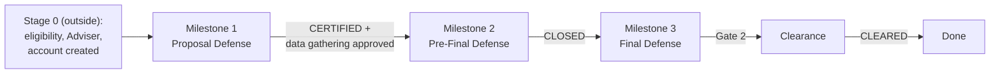

# PUP CpE Thesis Progress System — Product Requirements Document (v1.2 draft)

**Compliance standard:** Simplified Technical English (ASD-STE100) at about 80%
**Purpose of this file:** A short, scannable PRD. Detail lives in the supporting documents (Section 17).
**Marker `[CONFIRM]`:** A proposal from the drafter. It needs the owner's decision.

## Document control

| Item | Value |
| :---- | :---- |
| Product | PUP CpE Thesis Progress Monitoring System |
| Version | 1.2 draft |
| Date | 18 Nov 2026 |
| Owner | Nanashi |
| Program | PUP Graduate Computer Engineering (Master's and Doctoral) |
| Status | Draft for owner review |
| Main reader | `[CONFIRM]` Not set. This draft assumes all readers: capstone reviewers, the dev team, and the PUP CpE Program. |
| Source of truth for the process | *Unified Thesis Process, Screens and Sitemap* v1.0 (15 Nov 2026) |
| Companion files | Functional Requirements v1 (107 active FRs); Operational Flow, DFD and Sitemap v3 |

---

## 1. Problem statement `[CONFIRM]`

The PUP CpE graduate thesis moves through three milestones (Proposal, Pre-Final, Final) and a clearance step. Students, Advisers, Panel Members and the Coordinator work from 13 TDW forms and written guidelines. The signed paper is the official record.

The drafter found these problems in the project files. The owner must confirm them.

| No. | Problem | Who feels it |
| :---- | :---- | :---- |
| P1 | The steps, forms and signers are spread across many documents. A Student does not see the next step. | Student |
| P2 | Feedback is not tied to a manuscript version. Comments get lost between revisions. | Student, Adviser, Panel Member |
| P3 | Consultation records (TDW 03) are kept by hand. | Adviser, Student |
| P4 | People check the rules by hand: the 7-day notice, the manuscript lock, and the match between paper and file. | Coordinator |
| P5 | No one has one view of who is blocked and why. | Coordinator, Adviser |

## 2. Vision and goals

**Vision:** One place where every person sees the same status, the same file version and the next action.

| ID | Goal | Linked problems |
| :---- | :---- | :---- |
| G1 | Each Student always sees one next action. | P1 |
| G2 | Feedback stays tied to a manuscript version. | P2 |
| G3 | The system enforces the process rules. The signed paper stays the record. | P4 |
| G4 | The Coordinator verifies documents and closes stages from one place. | P4, P5 |
| G5 | Users get timely event emails and in-app notifications. | P1, P5 |
| G6 | The Adviser keeps consultation records without extra paperwork. | P3 |

## 3. Target users

| Role | Priority | Main needs | Portal |
| :---- | :---- | :---- | :---- |
| **Student** | Primary | Next action, version-based feedback, forms, schedule, results | `/student` |
| **Adviser** | Primary | Review queue, endorsement, consultation log, advisee status | `/adviser` |
| **Panel Member** | Secondary | Manuscript access after appointment, Defense Day entry, threads at the Final Defense | `/panel` |
| **Coordinator** | Primary | Accounts, appointments, document checks, date confirmation, stage close | `/coordinator` |

Rules for all roles:
- Each account has one role. Adviser, Panel Member and Coordinator are mutually exclusive (BR-03).
- "Lead Panel Member" and "Panel Chair" are designations for one Student, not roles.

**Not users of the system:** the Dean, the registrar, and the outside offices (ethics, IPMO, RPO, copyright). They work on paper. The Coordinator records their results.

## 4. User stories (traceable to requirements)

Each story maps to Functional Requirements (FR). Every active FR maps to at least one story.

| ID | Story | FR |
| :---- | :---- | :---- |
| US-01 | As a Student, I want to see my status and next action, so that I know what to do. | TRK-01, TRK-05, WFL-12, WFL-13 |
| US-02 | As a Student, I want to upload manuscript versions and see feedback tied to each version. | REV-01, REV-02, REV-03, REV-05 |
| US-03 | As a Student, I want to reply to threads, tag what I fixed and mark a version Ready. | REV-06, REV-07, REV-08, REV-14 |
| US-04 | As a Student, I want to book consultations, including online ones with a meeting link. | SCH-01, SCH-02, SCH-03, SCH-04 |
| US-05 | As a Student, I want to pick a defense date from valid dates. | SCH-08, DEF-01 |
| US-06 | As a Student, I want to download prefilled forms and upload my signed scans. | DOC-01, DOC-02, DOC-03, DOC-04, DOC-05, DOC-09, DOC-11, DEF-02 |
| US-07 | As a Student, I want to read my defense results and the Minutes. | DEF-11, DEF-12 |
| US-08 | As a Student, I want to complete clearance steps and see what is left. | CLR-01, CLR-02 |
| US-09 | As an Adviser, I want to review versions, post threads and endorse for committee review. | REV-04, REV-09, WFL-03, WFL-05, WFL-11 |
| US-10 | As an Adviser, I want to publish slots and keep the consultation log. | SCH-01, SCH-02, SCH-05, SCH-06 |
| US-11 | As an Adviser, I want to monitor my advisees. | TRK-02, TRK-06 |
| US-12 | As an Adviser, I want to endorse at Gate 1b and Gate 2 and complete my defense sheet. | WFL-04, WFL-07, DEF-05, DEF-06 |
| US-13 | As a Panel Member, I want to read the manuscript once I am appointed and my NDA is recorded. | CMT-05, REV-03, REV-15, TRK-03 |
| US-14 | As a Panel Member, I want to review and comment at committee review (Milestones 1 and 2). | REV-04, REV-11, WFL-04, WFL-05 |
| US-15 | As a Panel Member, I want to encode my evaluation on Defense Day and post threads at the Final Defense. | DEF-05, DEF-06, REV-12 |
| US-16 | As a Lead Panel Member or Panel Chair, I want to record the verdict. | DEF-07 |
| US-17 | As a Panel Member, I want to publish my defense availability. | SCH-07 |
| US-18 | As a Coordinator, I want to create accounts and manage users. | ACC-04, ACC-05, ACC-06, ACC-07 |
| US-19 | As a Coordinator, I want to appoint committees and panels, and record substitutes. | CMT-01, CMT-02, CMT-03, CMT-04, CMT-06 |
| US-20 | As a Coordinator, I want to verify documents and confirm the date and room. | DOC-06, DOC-07, DOC-08, DEF-03, DEF-04 |
| US-21 | As a Coordinator, I want to verify sheets, issue the Minutes and close the stage. | DEF-08, DEF-09, DEF-10, WFL-06, WFL-08, WFL-09, REV-13 |
| US-22 | As a Coordinator, I want to track outside statuses and close clearance. | WFL-10, CLR-03, CLR-04 |
| US-23 | As a Coordinator, I want a program overview and CSV reports. | TRK-04, RPT-03 |
| US-24 | As a Coordinator, I want an audit trail of gate actions and returns. | RPT-01, RPT-02, WFL-14 |
| US-25 | As a Coordinator, I want to manage milestone templates and parameters. | TPL-01, TPL-02, TPL-03, TPL-04, TPL-05 |
| US-26 | As any user, I want in-app and email notifications for events that need me. | NTF-01 to NTF-10 |
| US-27 | As any user, I want to search and save filters. | RPT-04 |
| US-28 | As any user, I want one read-only submission view after Gate 1b. | SUB-01 to SUB-05, DOC-10 |
| US-29 | As any user, I want to sign in and see only what my role allows. | ACC-01, ACC-02, ACC-03, ACC-08 |
| US-30 | As a Coordinator, I want the system to open milestones in order and keep one status for each. | WFL-01, WFL-02 |

## 5. Scope

### 5.1 In scope

| Module | Name | Active FRs | Must | Should | Could |
| :---- | :---- | :---- | :---- | :---- | :---- |
| ACC | Accounts and access | 8 | 7 | 1 | 0 |
| TPL | Templates and parameters | 5 | 3 | 2 | 0 |
| WFL | Workflow and gates | 14 | 13 | 1 | 0 |
| CMT | Committees and panels | 6 | 5 | 1 | 0 |
| REV | Manuscript and review | 14 | 9 | 5 | 0 |
| DOC | Documents and forms | 11 | 7 | 4 | 0 |
| SCH | Consultations and availability | 8 | 7 | 1 | 0 |
| DEF | Defense | 12 | 12 | 0 | 0 |
| CLR | Clearance | 4 | 4 | 0 | 0 |
| NTF | Notifications and email | 10 | 5 | 4 | 1 |
| TRK | Dashboards and tracking | 6 | 4 | 2 | 0 |
| RPT | Audit, reports and search | 4 | 1 | 3 | 0 |
| SUB | Shared submission view | 5 | 0 | 5 | 0 |
| | **Total** | **107** | **77** | **29** | **1** |

### 5.2 Out of scope and deferred

| Item | Status | Reason |
| :---- | :---- | :---- |
| E-signature | Out of scope | Paper stays the record (BR-01) |
| Subject grade and grade equivalent | Out of scope | Encoded in a separate grading system |
| Work by outside offices (ethics, IPMO, RPO, copyright, statistics, editing) | Out of scope | The system shows status only |
| GS Form 08 (Application for Graduation) | Out of scope | Not in the flow |
| News and announcement emails | Deferred | Other messaging apps do this better |
| Submission pre-check (NF-04) | **Paused** | Owner wants more time on the architecture |
| AI Agent features (FR-AIA-01 to 03) | Deferred | ADR-007 |
| Compare view (NF-02), print-match cover sheet (NF-05), Defense Day autosave and private notes (NF-16) | Not selected | |
| Calendar file download | Removed | Online consultations use a meeting link |

## 6. Core user journey

The thesis runs through three milestones. Each milestone uses the same 14-step defense cycle. Stage 0 happens outside the system.

| Cycle step | What happens |
| :---- | :---- |
| 1 to 3 | The Student writes, consults, replies to threads and marks a version Ready. |
| 4 | Gate 1a: the Adviser endorses for committee review. |
| 5 to 7 | The Coordinator appoints the committee. Panel Members review. Gate 1b locks the manuscript. |
| 8 to 11 | The Student picks a date. The Coordinator checks documents and confirms the date. Printed copies arrive. |
| 12 to 14 | Defense Day. The verdict is recorded. The Coordinator verifies sheets, issues the Minutes and closes the stage. |

Full detail: Operational Flow v3, Part 2.

## 7. Key product rules

These rules shape the whole product. The full list is BR-01 to BR-20 in the requirements file.

| No. | Rule |
| :---- | :---- |
| BR-01 | An in-system action shows intent. The wet-signed paper is the record. |
| BR-02 | Only the Coordinator closes a stage. |
| BR-03 | One role per account. |
| BR-07 | The manuscript locks at Gate 1b until the defense closes. |
| BR-09 | The defense date is at least 7 days after Gate 1b. Printed copies are due 7 days before. |
| BR-12 | A paper mismatch does not stop a defense. The stage cannot close until it is fixed. |
| BR-17 | Flags never block an action. |

## 8. Release phases `[CONFIRM]`

The drafter proposes four phases. The owner decides.

| Phase | Name | Content | Exit test |
| :---- | :---- | :---- | :---- |
| 0 | Technical spike | Neon sign-in, signed uploads, PDF view with range requests, direct hash check, Vercel deploy, daily cron, one email send, real file sizes from the uploaded repository | The spike answers R12 and R13 and settles AS-11 |
| 1 | Foundation and Milestone 1 | ACC, TPL, WFL (Milestone 1), CMT, REV core, DOC core, SCH core, DEF (Milestone 1), TRK dashboards, RPT-01 (audit log), NTF-01 (in-app) | One Student completes the Proposal Defense and CERTIFIED |
| 2 | Milestone 2 and email | IPMO status, TDW 09 and 10, revision items (REV-13), event emails (NTF-02 to NTF-09) | One Student completes the Pre-Final Defense |
| 3 | Milestone 3 and clearance | Defense Day threads (REV-12), Gate 2, CLR, shared submission view (SUB), dossier export | One Student reaches CLEARED |
| 4 | Enhancements | NF-01, 03, 06, 08, 09, 12, 13, 15, 17 to 20: change notes, review queue, form pack, forms guide, key dates, pacing flags, consultation prep, comment-response export, audit viewer, reports, template versioning, search | Chosen by value |

Notes:
- Phases follow the milestones. This matches the owner's milestone-by-milestone way of working.
- The paused pre-check is not in any phase.

## 9. Success measures `[CONFIRM]`

The drafter proposes these measures. Baselines are not known yet. The owner must set targets.

| ID | Measure | Goal | How to measure | Target |
| :---- | :---- | :---- | :---- | :---- |
| M1 | Share of pilot Students who name their next action correctly from S1 | G1 | Short task test | To be set |
| M2 | Share of feedback threads tied to a version | G2 | System data | 100% by design |
| M3 | Rule violations that get through (date under 7 days, upload after lock, gate with open threads) | G3 | Test cases and audit log | 0 |
| M4 | Coordinator time to verify one defense package | G4 | Timed trial against the paper method | To be set |
| M5 | Returns caused by missing or wrong documents | G4 | Audit log | Down from baseline |
| M6 | Events with a notification sent within the set time | G5 | Email log | To be set |
| M7 | Pilot usability score (SUS) | All | Questionnaire after a pilot | To be set |

## 10. Constraints

| Constraint | Source |
| :---- | :---- |
| Signed paper is the official record. Wet signatures. | BR-01 |
| The physical copy must match the uploaded file. | BR-12, DEF-04 |
| Master's and Doctoral programs are both in scope. | UD |
| One third-party feature service only: mail. Hosting, database, auth and files are infrastructure. | NFR-06 |
| All dates and times use Philippine Standard Time. | NFR-11 |
| The official Graduate School form files are needed for the form pack. | AS-08 |
| Free tiers only for every platform. | Owner decision |
| Stack chosen (Section 11.2). The repository sits on a personal GitHub account because of Vercel Hobby. | Owner decision |

## 11. Non-functional summary and technology stack

### 11.1 Non-functional summary

The full list is NFR-01 to NFR-13. Key points:

| Area | Requirement |
| :---- | :---- |
| Security | The server checks access on every read and write (NFR-01). |
| Integrity | SHA-256 hash for each commit and locked scan (NFR-02). Append-only audit log (NFR-03). |
| Reliability | An email failure never blocks a step (NFR-05). |
| Usability | One landing screen per role. Every disabled action shows its reason (NFR-04, BR-18). |
| Devices | Laptop and tablet screen widths (NFR-09). |
| Performance and availability | Targets are not set yet. Set them in the next gate (NFR-08). |

### 11.2 Technology stack (free tiers only)

The owner confirmed this stack: free tiers only, Neon for the database, auth and file store (one project), and Vercel for hosting. Vercel is for now. The owner will review other hosting options later.

| Layer | Choice | Free-tier note |
| :---- | :---- | :---- |
| Hosting | Vercel Hobby (for now; other hosting options are reviewed later). The repository sits on a personal GitHub account. | Non-commercial personal use only |
| Framework | Next.js 16 (App Router), React 19, TypeScript (strict), Node.js 20.9 or newer | Free |
| Database | Neon Postgres | 1 GB per project. 100 CU-hours per month. Compute scales to zero. |
| Authentication | Neon Auth (managed Better Auth), email and password | Up to 60,000 monthly users |
| File storage | Neon Object Storage (S3-style, Singapore region) with signed links | 5 GB per project |
| Email | Resend Free + React Email | 3,000 per month, 100 per day |
| Scheduled jobs | Vercel Cron | One run per day |
| UI | Tailwind CSS, shadcn/ui, Lucide, TanStack Table | Free |
| Forms | React Hook Form + Zod | Free |
| PDF | `react-pdf` (view), @pdfme/pdf-lib (fill forms), a zip library | Free |
| Dates | `date-fns`, `date-fns-tz` (Asia/Manila) | Free |
| Search | PostgreSQL full-text search | Free |
| Tests and CI | Vitest, Playwright, GitHub Actions | Free allowance |

**Rejected:** Supabase (1 GB files and a pause after a week idle), Vercel Blob (1 GB, with read and write caps), Cloudflare R2 (needs a payment method), Inngest or Trigger.dev, Tremor and Recharts, the AI libraries, `pgvector`, Langfuse.

### 11.3 Free-tier limits (checked 18 Nov 2026)

| Platform | Limits that matter |
| :---- | :---- |
| Vercel Hobby | Non-commercial personal use only. Cron runs at most once per day. Request and response bodies are limited to 4.5 MB. Function time limits differ between sources. |
| Neon Free | 1 GB database. 5 GB file storage. 100 CU-hours. 5 GB public network transfer per project per month. No card. |
| Resend Free | 3,000 emails per month and 100 per day |

Limits change. Check them again before release (R9).

### 11.4 Capacity estimate (5 GB of files)

The owner gave the manuscript size: 100 pages or more. **All other inputs are placeholders.** MB per page stays open, and so does the size of the TDW forms. The owner will upload the official TDW forms and sample files to a repository for checking (AS-11, AS-12). Update this table after that check.

| Input | Low | Typical | High |
| :---- | :---- | :---- | :---- |
| Pages: Milestone 1 (Chapters 1 to 3) | 50 | 50 | 50 |
| Pages: Milestone 2 | 120 | 120 | 120 |
| Pages: Milestone 3 | 130 | 130 | 130 |
| MB per page | 0.10 | 0.15 | 0.25 |
| Commits per milestone | 4 | 5 | 8 |
| Forms and evidence per Student | 90 MB | 90 MB | 90 MB |
| **Storage per Student, full lifecycle** | **about 210 MB** | **about 315 MB** | **about 690 MB** |
| **Full lifecycles in 5 GB** | **about 23** | **about 15** | **about 7** |

- With Milestone 1 only, the typical case is about 60 MB per Student. That fits about 85 Students.
- Download estimate: about 90 MB per active Student per month (2 uploads, 6 views, half the file loaded). That fits about 55 active Students in 5 GB. It is not yet known whether downloads count against the transfer limit (AS-13).
- Identical uploads can share one stored file. This keeps BR-19.
- The free tier gives pilot scale: a few cohorts, not the whole program.

### 11.5 Design rules from the stack

| No. | Rule |
| :---- | :---- |
| 1 | The browser uploads files directly to file storage with signed links. The server never receives file bytes (NFR-12). |
| 2 | The viewer reads PDFs through short-lived signed links. It uses range requests to load only the pages in view. |
| 3 | The browser computes the SHA-256 hash before upload. The server checks it after upload (NFR-02). |
| 4 | The browser never touches the database. One server-side data layer checks access for every read and write. Tests cover it (NFR-01). |
| 5 | Each commit uses a write-once file key. The system never issues a delete link. The audit table accepts inserts only (BR-19). |
| 6 | Event emails send at once from the server. One daily job sends reminders and digests. Digest events group per day. |
| 7 | The daily job runs in UTC. Philippine time is UTC+8, so the job time is converted (NFR-11). |

## 12. Risks and dependencies `[CONFIRM]`

| ID | Risk or dependency | Effect | Mitigation |
| :---- | :---- | :---- | :---- |
| R1 | Graduate School answers are pending (Section 15). | A rule may change. | Each question has a default. Rules sit in the template parameters. |
| R2 | Official form files are not yet in hand. | The form pack cannot match the official layout. | Get the files before Phase 2. |
| R3 | Faculty may not use the Defense Day page. | Missing entries. | The Coordinator verifies against the paper sheet (BR-12). |
| R4 | One role per account does not match real faculty practice. | A faculty member cannot advise one Student and sit on another Student's panel. | Keep two pools. Review with the Program Chair. |
| R5 | Scope is large (107 FRs). | Delay. | Four phases. Milestone-based slices. |
| R6 | The mail service fails. | Missed emails. | The in-app bell still records every event (NFR-05). |
| R7 | Residency limit values are unverified. | Wrong warnings. | Warning only. Set values in the template. |
| R8 | Personal data and manuscripts need care. | Privacy risk. | Keep emails link-only. Set the retention period (NFR-07). |
| R9 | Free-tier limits can change. | Plan limits or features may shrink. | Check limits before release. Keep the stack portable: standard Postgres, S3-style files, open-source auth. |
| R10 | Vercel Hobby is for non-commercial personal use. | Department use may need review. | Host on Vercel for now. Review other free hosts later. |
| R11 | Free storage is 5 GB (about 7 to 23 full lifecycles). | A full cohort may not fit. | Pilot scope. Share identical files. Review sizes after the spike. |
| R12 | The file store is a new service. | Unknown maturity. | Run a technical spike before Phase 1. |
| R13 | It is unclear if downloads count against the 5 GB transfer limit. | Viewing may hit the cap. | Test in the spike. |
| R14 | One vendor holds the database, auth and files. | Lock-in. | Standard Postgres, S3-style API and open-source auth keep exit paths open. |
| R15 | Cron runs once per day. | Reminders and digests are daily. | Accept daily timing. Add a scheduler later if needed. |

## 13. Decision log

| ID | Decision | Notes |
| :---- | :---- | :---- |
| D-01 | Two-layer approval. Paper is the record. | No e-signature. |
| D-02 | Stage 0 is outside the system. The Coordinator creates the account after eligibility. | |
| D-03 | One role per account. Adviser, Panel Member and Coordinator are exclusive. | Restores ADR-001. |
| D-04 | The panel role is named "Panel Member". Designations: Lead Panel Member, Panel Chair. | "Evaluator" dropped. |
| D-05 | Only the Coordinator closes a stage. | |
| D-06 | Three comment contexts: iteration, committee review, Defense Day. | |
| D-07 | At the Final Defense, Panel Members post threads from the scheduled start to Gate 2. Threads are the revision tracker at the Final. | Option A |
| D-08 | Revision items from the Minutes are used at Proposal and Pre-Final only. | |
| D-09 | Shared submission view opens at Gate 1b. Four routes, one screen. | |
| D-10 | Event emails are automatic with fixed templates and links only. News emails are deferred. | |
| D-11 | Online consultations carry a meeting link. No calendar file. | |
| D-12 | The pre-check (NF-04) is paused. | |
| D-13 | Times use Philippine Standard Time. | |
| D-14 | Free tiers only for every platform. | Owner decision |
| D-15 | Hosting on Vercel Hobby for now. Other hosting options are reviewed later. | Owner decision |
| D-16 | Neon Free for database, auth and file storage. | Owner confirmed. Replaces Supabase. |
| D-17 | Resend Free for email. | It has a free option. |
| D-18 | The browser uploads files directly with signed links. | 4.5 MB request limit on the host |
| D-19 | One daily job. Digests group per day. | Once-per-day cron limit |
| D-20 | File limit 50 MB. | Proposed |

## 14. Assumption index

| ID | Status |
| :---- | :---- |
| AS-01 | Closed (Defense Day threads at the Final Defense) |
| AS-02 | Confirmed |
| AS-03 | Confirmed |
| AS-04 | Closed (one role per account) |
| AS-05 | Confirmed. The threshold value is set in this PRD cycle. |
| AS-06 | Confirmed |
| AS-07, AS-09 | Deferred with the pre-check |
| AS-08 | Confirmed. Action: get the official form files. |
| AS-10 | Confirmed |
| AS-11 | Open. MB per page (manuscript and TDW forms) stays open until the owner uploads the real files. The 50 MB limit is proposed. |
| AS-12 | Open. TDW form page counts and commits per milestone are unverified. |
| AS-13 | Open. Prototype the file store and check the transfer limit. |

## 15. Open questions

| ID | Question | Default used |
| :---- | :---- | :---- |
| Q1 | Who is the main reader of this PRD? | All readers |
| Q2 | Can a faculty member upload their own signed scan, or only the Student and the Coordinator? | Student and Coordinator only |
| Q3 | What are the success targets (Section 9)? | Not set |
| Q4 | What is the value of the "commit waiting too long" threshold? | Not set |
| Q5 | How many commits does a milestone usually have? | 5 |
| Q6 | What are the real sizes and page counts of the TDW forms? The owner will upload them to a repository. | Placeholder: 90 MB per Student for forms and evidence |
| Q7 | Which hosting will the system use long term? | Vercel Hobby for now. Review other options later (R10). |
| G3 | When is the honorarium paid? | OR uploaded before date confirmation |
| G5 | How many attempts after Disapproved? Is there a re-defense fee? | New attempt allowed |
| G6, G17 | Who proposes the date? Does the Dean approve it? | Student proposes. Coordinator confirms. |
| G10 | Similarity threshold? | IPMO decides. Status only. |
| G12 | Is the residency limit a block or a warning? | Warning only |
| G13 | Late printed copies? | Coordinator sees a warning |
| G14 | Which ethics board applies? | Coordinator sets the status |
| G15 | Official form for the Certification of Proposal Approval? | Paper form from the Graduate School |
| G16, G21 | Printed and final copy counts and due dates | Not defined |
| G18 | Does the Adviser complete a TDW 13 sheet? | No |
| G19 | Do conference and journal items block clearance? | Both required, any order |
| G20 | Who issues the Certificate of Compliance? | Checklist shown as exit view |
| G22 | Which office handles copyright? | Status only |
| G23 | Is GS Form 08 in this flow? | Not in the flow |
| PK2 | Does a substitute need a paper amendment? | Coordinator records the substitute |

## 16. PRD quality check (self-review)

This check follows the quality dimensions used by the Opc_Kit PRD skill. It gives no score. It shows what is ready.

| Dimension | State | Gap |
| :---- | :---- | :---- |
| Completeness | Partial | Sections 1, 8, 9 and 12 need the owner's confirmation. |
| Traceability (story to FR) | Met | Every active FR maps to a story (Section 4). |
| Testability | Partial | FRs use "must" statements. Acceptance criteria are not yet written. |
| Clarity | Met | One glossary. One role model. |
| Exception coverage | Partial | Failure paths exist for email and mismatch. Other failure paths need review. |
| Metrics alignment | Partial | Measures are proposed. Targets are not set. |
| Risk management | Partial | Risks are proposed. The owner must review them. |

## 17. Supporting documents

| Document | Role | Status |
| :---- | :---- | :---- |
| `Functional_Requirements_v1.md` | Spec: FR, BR, NFR, AS | Done |
| `Operational_Flow_DFD_Sitemap_v3.md` | Flow, DFD, sitemap | Done |
| Unified Thesis Process (Claude Doc) | Process source of truth | Done |
| `data-model.md` (ERD, Mermaid) | First ERD from the candidate entities | Next |
| `constitution.md` | Project principles (for example BR-01, BR-03, BR-17) | Planned |
| `AGENTS.md` with a `CLAUDE.md` pointer | Context for AI coding agents | Planned |
| Acceptance criteria | Tests per FR | Planned |
| Repository with the official TDW forms and sample files | Check sizes and page counts. Feeds the form pack (AS-08) and the capacity estimate. | Owner to upload |

## 18. Reference notes (templates used)

The drafter chose these references after reviewing public repositories. The notes list what this PRD borrows.

| Reference | What we borrowed | Where |
| :---- | :---- | :---- |
| `sacrtap/Opc_Kit` (create-prd skill) | Fixed chapter order, user story to FR traceability, decision log, glossary, assumption index, change log, quality dimensions | Sections 4, 13, 14, 16, 19 |
| `cliangdev/specflux` (prd-template) | Short core PRD for people. Detail in supporting files. Mermaid for flows, data model and states. Out-of-scope list. | Sections 5, 6, 17 |
| `github/spec-kit` | Constitution, stable requirement IDs, independent stories, assumptions, measurable outcomes, a data-model file, task IDs | Sections 4, 14, 17 |
| `senivel/domain-context` | Keep business rules and glossary apart from build instructions | Section 7, Section 17 |
| AGENTS.md open format | One entry file for AI agents, with a CLAUDE.md link | Section 17 |

Not used now: BMAD agent roles, spec-mix extras, the MCP PRD server. Reason: they add tooling and the stack is not chosen.

Source repositories:
- https://github.com/sacrtap/Opc_Kit
- https://github.com/cliangdev/specflux
- https://github.com/github/spec-kit
- https://github.com/senivel/domain-context
- https://agents.md/

## 19. Change log

| Version | Date | Change |
| :---- | :---- | :---- |
| 1.0 draft | 18 Nov 2026 | First draft from the project files. Sections 1, 8, 9, 12 and the audience are proposals. |
| 1.1 draft | 18 Nov 2026 | Adds Section 11 (stack, limits, capacity, design rules), Phase 0, constraints, risks R9 to R15, decisions D-14 to D-20, assumptions AS-11 to AS-13, questions Q5 to Q7. |
| 1.2 draft | 18 Nov 2026 | Owner confirmed Neon (database, auth, files) and Vercel for now. MB per page and TDW form sizes stay open until the owner uploads the files. Q6 and Q7 reworded. |
