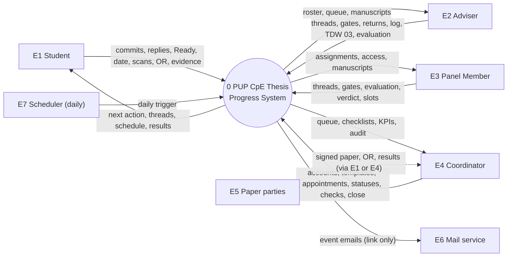
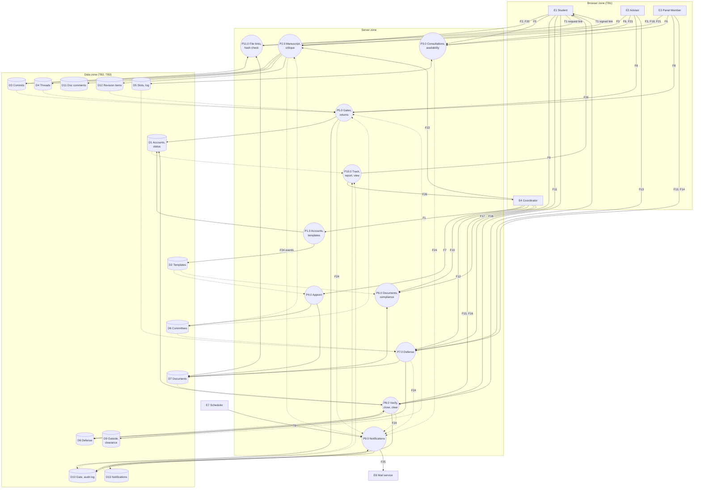
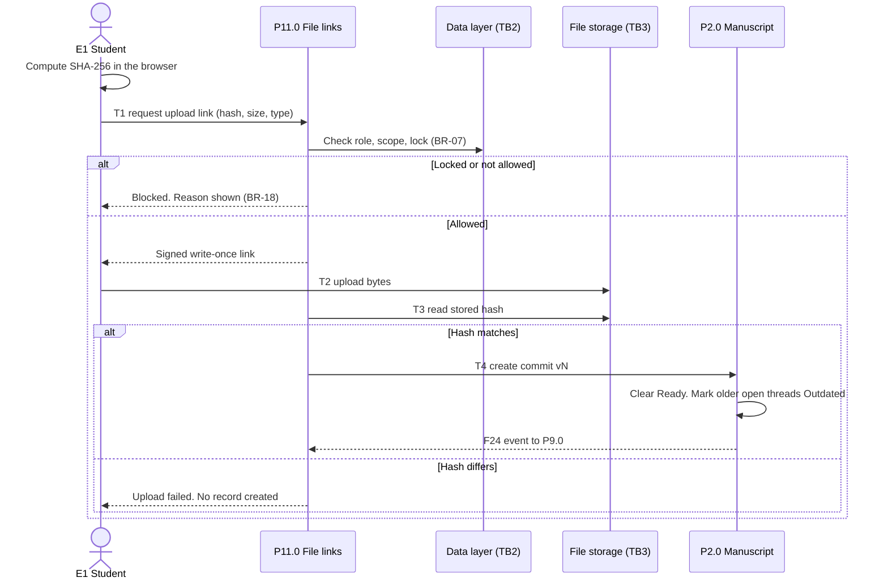
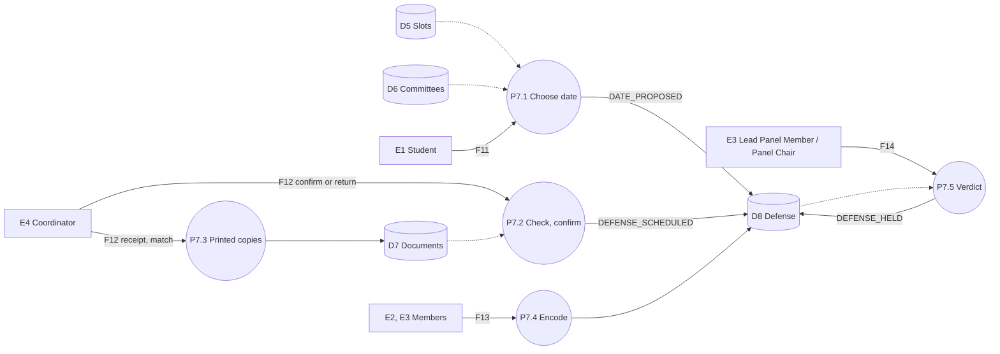

# DFD — PUP CpE Thesis Progress Monitoring System

**Compliance standard:** Simplified Technical English (ASD-STE100) at about 80%
**Version:** 1.0 draft · 22 Nov 2026
**Derived from:** Operational Flow, DFD and Sitemap v3.1 (Part 3), Functional Requirements v1.1, `PRD.md` §11.3 (design rules from the stack)
**Rule for this file:** This file holds no new process rule. It adds trust boundaries and the technical flows from the stack. If it disagrees with a governing document, the governing document wins. Correct this file.
**Companion files:** `ERD.md` (tables behind each store), `USERFLOW.md`, `SITEMAP.md`

---

## 0. How to read this file (for agents)

- The **tables are the source of truth**. The Mermaid diagrams are views of the tables. If a diagram and a table disagree, the table wins.
- Every element has a stable ID. Use the ID in code comments, tests and issues.

| Prefix | Element | Example |
| :---- | :---- | :---- |
| `E` | External entity (a person or a system outside our code) | `E1` Student |
| `P` | Process (our code that changes or moves data) | `P7.0` Schedule and run the defense |
| `D` | Data store (tables or files at rest) | `D3` Manuscript commits |
| `F` | Business data flow | `F11` Proposed date |
| `T` | Technical data flow (from the stack design rules) | `T1` Signed upload link |
| `TB` | Trust boundary | `TB1` Browser to server |

**Model checks.** A valid change to this DFD keeps all of these true:
1. Each process has at least one input flow and one output flow.
2. No flow goes directly from an external entity to a store, or from a store to an external entity. A process is always between them. The one exception is `T2`: the browser writes file bytes to storage with a signed link that a process issued (`T1`).
3. No flow goes directly from one store to another store.
4. Each flow names a rule (BR, FR, NFR or design rule) or the text "no guard".
5. Each store maps to tables in `ERD.md` §3.

---

## 1. Elements

### 1.1 External entities

| ID | Entity | Zone | Sends | Receives |
| :---- | :---- | :---- | :---- | :---- |
| E1 | Student | Browser | Commits, replies, Ready mark, consultation requests, date choice, signed scans, OR, clearance evidence | Next action, threads, schedule, results, Minutes, clearance status |
| E2 | Adviser | Browser | Threads, Gate 1a, 1b, 2, Returns, log confirmations, TDW 03 scan, slots, own evaluation, data-gathering approval | Roster, action queue, manuscripts, schedule |
| E3 | Panel Member | Browser | Threads, Gate 1b, 2, Returns, defense slots, own evaluation, verdict (Lead Panel Member or Panel Chair) | Assignments, access status, manuscripts, schedule |
| E4 | Coordinator | Browser | Accounts, templates, appointments, scans, outside statuses, date and room, receipts, sheet checks, Minutes, close actions | Action queue, checklists, KPIs, audit, exports |
| E5 | Paper parties (Dean, registrar, IPMO, RPO, ethics board, copyright office) | Paper | Signed forms, OR, check results, through E1 or E4 only | Nothing directly |
| E6 | Mail service (Resend) | Third party | Send result | Event emails, link only |
| E7 | Scheduler (Vercel Cron, once per day) | Platform | Daily trigger at 00:00 UTC | Nothing |

### 1.2 Processes

| ID | Process | Actors | Reads | Writes | FR modules |
| :---- | :---- | :---- | :---- | :---- | :---- |
| P1.0 | Manage accounts, users and templates | E4 | D2 | D1, D2 | ACC, TPL |
| P2.0 | Manage manuscript and critique | E1, E2, E3 | D1, D6 | D3, D4, D11, D12 | REV |
| P3.0 | Manage consultations and availability | E1, E2, E3 | D1, D5 | D5 | SCH |
| P4.0 | Appoint committee and panel | E4 | D1, D2, D5 | D6, D7 | CMT |
| P5.0 | Control gates and returns | E2, E3, E4 | D3, D4, D6, D7, D9, D12 | D1, D10 | WFL |
| P6.0 | Manage documents and compliance | E1, E2, E4 | D2, D7 | D7, D10 | DOC |
| P7.0 | Schedule and run the defense | E1, E2, E3, E4 | D1, D2, D5, D6, D7 | D7, D8 | DEF |
| P8.0 | Verify, close and clear | E1, E3, E4 | D7, D8, D9 | D1, D8, D9, D10 | DEF, CLR |
| P9.0 | Manage notifications and email | System | D1, D2, D13, events from P2.0 to P8.0 | D13, D10 | NTF |
| P10.0 | Track, report, audit and view | All roles | D1 to D13 | D1 (saved filters only) | TRK, RPT, SUB |
| P11.0 | Issue file links and check file hashes | System | D3, D7 | D3, D7 | NFR-02, NFR-12 |

`P11.0` is new in this file. It is the server code that issues short-lived signed links and checks the SHA-256 hash after upload (PRD §11.3, rules 1 to 3). It adds no process rule.

### 1.3 Data stores

| ID | Store | Holds | Tables (`ERD.md`) | Write mode |
| :---- | :---- | :---- | :---- | :---- |
| D1 | Accounts and milestone status | Users, thesis instances, milestone status, saved filters | `app_user`, `thesis_instance`, `milestone_instance`, `saved_filter` | Update allowed |
| D2 | Templates and parameters | Template versions, required items, rubric, email wording | `milestone_template`, `template_version`, `template_required_item`, `rubric_indicator`, `email_template` | New version per change |
| D3 | Manuscript commits | Submission PRs, commit files, hashes, Ready mark, lock | `submission_pr`, `manuscript_commit`, file storage `commits/` | Commits are insert-only (BR-19) |
| D4 | Critique threads | Threads, replies, Addressed tags | `critique_thread`, `thread_reply`, `thread_address_tag` | Update of state only |
| D5 | Slots and consultation log | Slots, bookings, linked threads, log entries | `slot`, `booking`, `booking_thread_link`, `consultation_log_entry` | Update allowed |
| D6 | Committees, panels, NDAs | Committees, members, designations, substitutes | `committee`, `committee_member`, `defense_substitute` | Update allowed |
| D7 | Document records | Documents, files, state history, printed copies | `document_record`, `document_file`, `document_event`, `printed_copy_receipt`, file storage `documents/` | Files and events are insert-only (BR-19) |
| D8 | Defense records | Attempts, entries, scores, comments, Minutes | `defense_attempt`, `evaluation_entry`, `evaluation_score`, `evaluation_comment`, `minutes` | Entries editable until verified |
| D9 | Outside statuses and clearance | Outside status history, clearance items | `outside_status_event`, `clearance_item` | Status events are insert-only |
| D10 | Gate and activity log | Gate actions, audit records | `gate_action`, `audit_record` | Insert-only (BR-19, NFR-03) |
| D11 | Document comments | Panel Member comments on scans and files (M1, M2) | `document_comment` | Update of state only |
| D12 | Revision items | Minutes items, linked commit, acceptances | `revision_item`, `revision_acceptance` | Update allowed |
| D13 | Notifications and email log | Notifications, email log, preferences | `notification`, `email_log`, `notification_preference` | Email log is insert-only |

### 1.4 Trust boundaries

| ID | Boundary | Between | What crosses it | Control |
| :---- | :---- | :---- | :---- | :---- |
| TB1 | Browser to server | E1 to E4 and the app (P1.0 to P11.0) | All user actions and reads | Sign-in (Neon Auth). Route check per role (FR-ACC-02). Server data-layer check on every read and write (NFR-01). |
| TB2 | Server to database | Processes and D1 to D13 tables | Rows | Only the server data layer connects. The browser never touches the database (PRD §11.3 rule 4). |
| TB3 | Browser to file storage | E1 to E4 and file storage | File bytes | Short-lived signed links from P11.0 only. Write-once keys. No delete link (NFR-12, BR-19). |
| TB4 | Server to mail service | P9.0 and E6 | Email: event, next action, deadline, link | No manuscript text, comments, scores, verdicts or meeting links (FR-NTF-03). |
| TB5 | Paper to system | E5 and E1 or E4 | Scans of signed paper, statuses | The paper is the record (BR-01). A scan is provisional until the Coordinator verifies it. |

---

## 2. Level 0: context

## 3. Level 1: processes and stores

The diagram shows the main flows only. Section 4 lists every flow.

## 4. Flows

### 4.1 Business flows (from Operational Flow v3.1, §3.4)

| ID | From | To | Data | Guard | Source |
| :---- | :---- | :---- | :---- | :---- | :---- |
| F1 | E4 | P1.0 | New account data | Only after eligibility. One role per account. | FR-ACC-04, BR-03 |
| F2 | E1 | P2.0 | New commit (metadata; bytes go by T2) | Blocked while locked. Clears Ready. Marks older open threads Outdated. | BR-07, FR-REV-02, BR-06 |
| F3 | E2, E3 | P2.0 | Thread, reply, resolve | Only the author resolves. | BR-05 |
| F4 | P2.0 | E2, E3 | Manuscript, threads | Panel Member reads only after the form and that member's NDA are recorded, and until the access ends. | BR-08, BR-21 |
| F5 | E1 | P3.0 | Consultation request, agenda, linked threads | Slot goes Available, Pending, Confirmed. | FR-SCH-02, FR-SCH-04 |
| F6 | E2, E3 | P3.0 | Slot, confirmation, log edit | No minimum consultation count. | BR-16 |
| F7 | E4 | P4.0 | Appointment, NDA scans, substitute | Panel Member accounts only. Never the Student's Adviser. | BR-03, FR-CMT-06 |
| F8 | E2, E3 | P5.0 | Gate 1a, Gate 1b, Gate 2, Return | Own threads resolved. Return needs a reason. RETURNED goes back to DRAFT. | FR-WFL-03, 04, 05, 07, BR-13, FR-WFL-02 |
| F9 | E1 | P6.0 | Signed scan, OR (metadata; bytes go by T2) | Provisional. Locks on upload. A replacement needs a Return. | FR-DOC-03, BR-19 |
| F10 | E4 | P6.0 | Verify or Return, outside status | Coordinator Return: compliance or eligibility only. | BR-13, BR-14 |
| F11 | E1 | P7.0 | Proposed date | At least 7 days after Gate 1b. Common free dates only. | BR-09, FR-SCH-08 |
| F12 | E4 | P7.0 | Date and room or link, printed-copy receipt and match | Blocked until the checklist is complete. | FR-DEF-03, FR-DOC-08, FR-DEF-04 |
| F13 | E2, E3 | P7.0 | Own evaluation entry | Opens at the scheduled start. Editable until verified. | BR-10, FR-DEF-06 |
| F14 | E3 (Lead Panel Member or Panel Chair) | P7.0 | Collective verdict | On or after the defense date. Warn if Action Taken differs. | FR-DEF-07 |
| F15 | E4 | P8.0 | Sheet scans, match result, Minutes, close | Every sheet verified and Minutes issued. | FR-DEF-08 to 10, BR-12 |
| F16 | E4 | P8.0 | Certification, Gate 2 record, clearance verification | By milestone rule. Only the Coordinator sets closing statuses. | BR-02, FR-WFL-06, 07, FR-CLR-04 |
| F17 | E1 | P8.0 | Clearance evidence | Conference and journal items, any order. | FR-CLR-02 |
| F18 | P8.0 | E1 | Defense results, Minutes | Only after the Coordinator verifies the sheets. No grade equivalent. | BR-11, BR-15 |
| F19 | E3 | P2.0 | Defense Day thread, reply, resolve | Scheduled start of the Final Defense to Gate 2. Student sees threads at close. | BR-20, FR-REV-12 |
| F20 | E1 | P2.0 | Change note, Addressed tag | The tag does not change thread state. | FR-REV-08 |
| F21 | E3 | P2.0 | Document comment (M1, M2) | The author resolves their own comment. | FR-REV-11 |
| F22 | E4 | P2.0 | Minutes recommendations as revision items | Proposal and Pre-Final only. | FR-REV-13 |
| F23 | E2 | P3.0 | Online slot with meeting link | Only the Adviser and the booked Student see the link. | FR-SCH-03 |
| F24 | P2.0 to P8.0 | P9.0 | Events | One event list feeds the bell and the email. | FR-NTF-01 |
| F25 | P9.0 | E6 | Event email | Fixed template. Link only. Digest and opt-out rules. | FR-NTF-02 to 05 |
| F26 | P10.0 | E1 to E4 | Dashboards, key dates, pacing flags, search, audit, exports, shared view | Read-only. Data scope per role. Flags never block. | BR-04, BR-17, FR-SUB |

### 4.2 Technical flows (from `PRD.md` §11.3)

| ID | From | To | Data | Guard | Source |
| :---- | :---- | :---- | :---- | :---- | :---- |
| T1 | E1 to E4 | P11.0 | Request for an upload or read link, with the SHA-256 hash from the browser | The data layer checks the role and scope first. For commits: the manuscript is not locked. | NFR-01, NFR-12, BR-07 |
| T2 | E1 to E4 | File storage (D3, D7) | File bytes | Signed link only. Write-once key. Size and type check (NFR-10). The server never receives the bytes. | NFR-12, NFR-10, BR-19 |
| T3 | File storage | P11.0 | Stored file hash | The server checks the stored hash against the browser hash. On mismatch, the record is not created. | NFR-02 |
| T4 | P11.0 | D3, D7 | Commit or document file record | Only after T3 passes. | NFR-02 |
| T5 | File storage | E1 to E4 | PDF page ranges | Short-lived signed read link. Range requests load only the pages in view. | PRD §11.3 rule 2 |
| T6 | E7 | P9.0 | Daily trigger | 00:00 UTC (about 08:00 Philippine time). Sends reminders and digests. | FR-NTF-04, FR-NTF-06, NFR-11 |
| T7 | Every process | D10 | Audit record | Insert only. Actor, role, time, target. | FR-RPT-01, NFR-03 |

## 5. Level 2 views

### 5.1 P2.0 and P11.0: upload a commit

### 5.2 P7.0: schedule and run the defense

| Sub-process | Trigger | Input flows | Output | Guard |
| :---- | :---- | :---- | :---- | :---- |
| P7.1 Choose date | Gate 1b done | F11 | `DATE_PROPOSED` | Dates under 7 days after Gate 1b are blocked (BR-09) |
| P7.2 Check and confirm | Date proposed and scans uploaded | F9, F12 | `DEFENSE_SCHEDULED` or `RETURNED` | Checklist complete (FR-DOC-08) |
| P7.3 Receive printed copies | Copies handed in | F12 | Receipt and match result in D7 | Due 7 days before. Late copies warn only. |
| P7.4 Encode evaluation | Scheduled start | F13 | Entry per member in D8 | Required. Editable until verified. |
| P7.5 Record verdict | Defense date reached | F14 | `DEFENSE_HELD` | Lead Panel Member (M1, M2) or Panel Chair (M3) only |

### 5.3 P9.0: notifications

| Step | Rule | Source |
| :---- | :---- | :---- |
| 1 | P2.0 to P8.0 send an event (F24). P9.0 writes one `notification` row for each recipient. | FR-NTF-01 |
| 2 | Immediate events: P9.0 sends the email at once (F25) and writes `email_log`. | FR-NTF-02 |
| 3 | Digest and reminder events (A4, B1, B2, B4, B6, B7, C2 to C5): the daily trigger (T6) groups and sends them. | FR-NTF-04, FR-NTF-06 |
| 4 | Final Defense thread emails to the Student start only when the defense closes. | FR-NTF-04, BR-20 |
| 5 | A user's preference turns off reminders and digests only. | FR-NTF-05 |
| 6 | A failed send writes a failed `email_log` row. The in-app notification stays. | NFR-05, FR-NTF-07 |

## 6. Traceability

| This file | Source |
| :---- | :---- |
| §1.1, §1.2, §1.3 | Operational Flow v3.1 §3.1, §3.3 (E6, E7 and P11.0 are added from PRD §11.3) |
| §1.4 Trust boundaries | NFR-01, NFR-12, FR-NTF-03, BR-01, PRD §11.3 |
| §4.1 | Operational Flow v3.1 §3.4 (F1 to F26) |
| §4.2 | PRD §11.3 rules 1 to 7 |
| §5.2 | Operational Flow v3.1 §3.5 |
| Store-to-table map | `ERD.md` §3 |
