# ERD — PUP CpE Thesis Progress Monitoring System

**Compliance standard:** Simplified Technical English (ASD-STE100) at about 80%
**Version:** 1.2 draft · 24 Nov 2026 · `[CONFIRM]` first ERD, for owner review
**Change in 1.2:** Follows Functional Requirements v1.2 (PRD D-24 to D-28). `document_state` loses `physical_received` and `mismatch` (FR-DOC-02). `critique_thread.page` added (FR-REV-04). `form_code` adds `TDW_01`, `TDW_02`, `TDW_04`, and `document_record.optional` marks the advising forms (FR-DOC-12). `template_version.advisee_limit` added (FR-TRK-06). The title is editable until Gate 1b (FR-ACC-09).
**Change in 1.1:** Checked against the Guidelines and TDW forms (`docs/reference/`). `GATE_2_SHEET` is now `SIGNED_FINAL_MANUSCRIPT` (C.23). `document_record.linked_commit_id` added (B.17, C.23). Access end added (BR-21, TDW 05 item 11). ERD-Q1 to Q3 resolved or sent to the Graduate School.
**Derived from:** Functional Requirements v1.2 (§2 business rules, §4 FRs, §6.3 candidate entities), `DFD.md` (stores D1 to D13), `PRD.md` §11 (Neon Postgres, design rules)
**Rule for this file:** This is the logical data model. It adds no process rule. It decides table shape only. If it disagrees with the Functional Requirements, the Functional Requirements win. Correct this file.
**Companion files:** `DFD.md`, `USERFLOW.md`, `SITEMAP.md`

---

## 0. How to read this file (for agents)

| Section | Use it to |
| :---- | :---- |
| §1 Conventions | Name and type columns the same way everywhere |
| §2 Enums | Use the exact status values. Do not invent new values. |
| §3 Entity catalog | Find the table for a concept, its DFD store and its FRs |
| §4 Diagram | See keys and relationships. Each column has a short comment. |
| §5 Relationships | Read the cardinality in words |
| §6 Invariants | Find the rule each table must keep, and where to enforce it |
| §7 State machines | Find the allowed status changes and who makes them |
| §8 Access scope | Find which rows each role can read and write |
| §9 Open points | See what is not decided |

- Write migrations from §4 and §6. Write tests from §6 and §7. Each invariant has an ID (`INV-nn`). Cite it in tests.
- Derived facts are **not stored**. Compute them in the data layer. They are listed in §4.2.

## 1. Conventions

| Item | Rule |
| :---- | :---- |
| Database | Neon Postgres. One schema `app`. Neon Auth keeps its own schema. |
| Names | `snake_case`. Tables are singular nouns. |
| Primary keys | `id uuid` (default `gen_random_uuid()`). Append-only logs use `id bigint` identity. |
| Foreign keys | `<table>_id`. Users are referenced as `<purpose>_user_id`, for example `adviser_user_id`. |
| Time | `timestamptz`, stored in UTC. The app shows Philippine Standard Time (NFR-11). Calendar days use `date`. |
| Files | Only the storage key, hash, size and type are in the database. The bytes are in Neon Object Storage (NFR-12). |
| Hash | `sha256 text`, 64 lowercase hex characters (NFR-02). |
| Deletes | No hard delete on any table that holds a record of an action (BR-19). Accounts are deactivated, not deleted. |
| Append-only | `manuscript_commit`, `document_file`, `document_event`, `gate_action`, `outside_status_event`, `email_log`, `audit_record`. The app role has INSERT and SELECT only. |
| Grades | No column holds a subject grade or a grade equivalent (BR-15). |
| Free text | Reasons, comments and notes are `text`, with no length limit in the database. The UI sets limits. |

## 2. Enums

| Enum | Values | Source |
| :---- | :---- | :---- |
| `user_role` | `student`, `adviser`, `panel_member`, `coordinator` | BR-03 |
| `degree_level` | `masters`, `doctoral` | FR-ACC-04 |
| `writing1_course` | `RSH_641`, `RSH_741` | FR-ACC-04 |
| `milestone_code` | `proposal`, `pre_final`, `final` | FR-TPL-02 |
| `milestone_status` | `DRAFT`, `READY`, `ADVISER_ENDORSED`, `COMMITTEE_APPOINTED`, `COMMITTEE_ENDORSED`, `DATE_PROPOSED`, `DEFENSE_SCHEDULED`, `DEFENSE_HELD`, `CLOSED`, `RETURNED`, `CERTIFIED` (M1 only), `FINAL_APPROVED` (M3 only), `CLEARED` (M3 only) | FR-WFL-02 |
| `comment_context` | `iteration`, `committee_review`, `defense_day` | Unified §2.12 |
| `thread_state` | `OPEN`, `RESOLVED` | FR-REV-04 |
| `committee_kind` | `evaluation_committee`, `final_panel` | FR-CMT-01 |
| `designation` | `none`, `lead_panel_member`, `panel_chair` | BR-03, FR-CMT-01 |
| `member_status` | `proposed`, `accepted`, `declined` | FR-CMT-03 |
| `gate_kind` | `gate_1a`, `gate_1b`, `certification`, `gate_2`, `date_confirmation`, `stage_close`, `clearance_close`, `data_gathering` | FR-WFL-03 to 11 |
| `gate_result` | `endorsed`, `returned`, `accepted`, `approved`, `recorded` | FR-WFL-14 |
| `document_state` | `not_started`, `prepared`, `scan_uploaded`, `locked_as_submitted`, `verified`, `returned` | FR-DOC-02 |
| `form_code` | `TDW_01` to `TDW_13`, `OR`, `ETHICS_CERT`, `CERTIFICATION`, `SIGNED_FINAL_MANUSCRIPT`, `MINUTES`, `FINAL_COPY`, `CONFERENCE_CERT`, `JOURNAL_PUB`, `SUPPORTING` | Unified App. A, Guidelines B.16, C.23, C.25 |
| `outside_kind` | `ethics`, `ipmo`, `rpo`, `copyright` | BR-14 |
| `outside_value` | Ethics: `NOT_SUBMITTED`, `UNDER_REVIEW`, `CHANGES_REQUIRED`, `APPROVED`. IPMO: `NOT_SUBMITTED`, `UNDER_CHECK`, `FAILED`, `PASSED`. RPO: `NOT_SUBMITTED`, `UNDER_EDITING`, `DONE`. Copyright: `NOT_APPLIED`, `APPLIED`, `REGISTERED`. | FR-WFL-10 |
| `slot_type` | `consultation`, `defense` | FR-SCH-01, 07 |
| `slot_mode` | `in_person`, `online` | FR-SCH-01 |
| `slot_status` | `available`, `pending`, `confirmed` | FR-SCH-02 |
| `booking_status` | `pending`, `confirmed`, `declined` | FR-SCH-02 |
| `defense_status` | `proposed`, `scheduled`, `held`, `closed` | FR-DEF-01 to 10 |
| `verdict` | `approved`, `approved_with_revisions`, `disapproved` | FR-DEF-05 |
| `evaluation_form` | `TDW_08`, `TDW_10`, `TDW_13` | FR-DEF-05 |
| `tdw10_section` | `title_prelims`, `chapter_1` to `chapter_5`, `references_appendices`, `remarks`, `general_observations` | Unified §2.6 |
| `match_result` | `pending`, `matched`, `mismatch` | FR-DEF-04, 08 |
| `clearance_kind` | `ipmo`, `rpo`, `gate_2`, `copyright`, `final_copy`, `conference_cert`, `journal_pub` | FR-CLR-01 |
| `email_result` | `sent`, `failed` | FR-NTF-07 |
| `event_code` | `A1` to `A6`, `B1` to `B7`, `C1` to `C6`, `E1` to `E3`, `F1`, `F2` | FR §4.10 |

## 3. Entity catalog

| Table | Purpose | Store | FRs |
| :---- | :---- | :---- | :---- |
| `app_user` | One account, one role | D1 | ACC-01, 05, 06, 08 |
| `thesis_instance` | One Student's thesis record and eligibility data | D1 | ACC-04, ACC-07, WFL-12 |
| `milestone_instance` | One milestone for one thesis, with one status | D1 | WFL-01, 02, 11, TPL-05 |
| `saved_filter` | A user's saved search | D1 | RPT-04 |
| `milestone_template` | The three milestone types | D2 | TPL-01, 02 |
| `template_version` | A frozen version of a template's parameters | D2 | TPL-01, 04 |
| `template_required_item` | A deliverable or form for a version | D2 | TPL-01, DOC-01, DOC-08 |
| `rubric_indicator` | A weighted rubric line (A1 to B3) | D2 | TPL-03, DEF-05 |
| `email_template` | Versioned email wording per event | D2 | NTF-02, NTF-10 |
| `submission_pr` | The container of commits for one milestone | D3 | REV-01, REV-07 |
| `manuscript_commit` | One ordinal manuscript upload | D3 | REV-02, REV-08 |
| `critique_thread` | Feedback tied to one commit | D4 | REV-04, 05, 06, 12 |
| `thread_reply` | One reply in a thread | D4 | REV-04, 06 |
| `thread_address_tag` | A commit says it addresses a thread | D4 | REV-08 |
| `slot` | A published consultation or defense slot | D5 | SCH-01, 03, 07 |
| `booking` | A Student's request for a consultation slot | D5 | SCH-02, 04 |
| `booking_thread_link` | Threads linked to a booking agenda | D5 | SCH-04 |
| `consultation_log_entry` | One TDW 03 row | D5 | SCH-05, 06 |
| `committee` | An Evaluation Committee or a Final Panel | D6 | CMT-01, 04 |
| `committee_member` | One Panel Member seat | D6 | CMT-01, 03, 04, 05 |
| `defense_substitute` | A substitute for one defense attempt | D6 | CMT-06 |
| `document_record` | One required document for one milestone | D7 | DOC-01 to 08 |
| `document_file` | One uploaded file of a document | D7 | DOC-03, 11 |
| `document_event` | One state change of a document | D7 | DOC-11, DOC-06 |
| `printed_copy_receipt` | Printed copies for one defense attempt | D7 | DEF-04 |
| `defense_attempt` | One defense, with date, room and verdict | D8 | DEF-01 to 03, 07, 10, 12, WFL-09 |
| `evaluation_entry` | One member's sheet for one attempt | D8 | DEF-05, 06, 08 |
| `evaluation_score` | One rubric score in a sheet | D8 | DEF-05 |
| `evaluation_comment` | One TDW 10 comment box, or the rubric comments box | D8 | DEF-05 |
| `minutes` | The Minutes of one attempt | D8 | DEF-09 |
| `outside_status_event` | One change of an outside status | D9 | WFL-10 |
| `clearance_item` | One clearance checklist item (M3) | D9 | CLR-01 to 04 |
| `gate_action` | One gate action, Return or close | D10 | WFL-03 to 08, 14 |
| `audit_record` | One audited action | D10 | RPT-01, 02 |
| `document_comment` | A Panel Member comment on a scan or file (M1, M2) | D11 | REV-11 |
| `revision_item` | One Minutes recommendation (M1, M2) | D12 | REV-13 |
| `revision_acceptance` | One member accepts one revision item | D12 | REV-13, WFL-04, 06 |
| `notification` | One in-app event for one user | D13 | NTF-01 |
| `email_log` | One email send attempt | D13 | NTF-07 |
| `notification_preference` | A user turns an optional event off | D13 | NTF-05, 09 |

## 4. Diagram

### 4.1 Entity-relationship diagram

```mermaid
erDiagram
    app_user {
        uuid id PK
        text auth_user_id UK "Neon Auth user id"
        text full_name
        text email UK "emails go here (FR-NTF-08)"
        user_role role "exactly one role (BR-03)"
        bool is_active "deactivate, never delete"
        timestamptz created_at
    }
    thesis_instance {
        uuid id PK
        uuid student_user_id FK,UK "one thesis per Student (BR-04)"
        uuid adviser_user_id FK "role must be adviser (FR-ACC-07)"
        text title "set at account creation; Student edits until Gate 1b (FR-ACC-09)"
        degree_level degree_level "sets committee size and copy counts"
        text program_start_term "residency warning source (FR-WFL-12)"
        date comprehensive_exam_date
        writing1_course writing1_course
        uuid created_by_user_id FK "Coordinator"
        timestamptz created_at
    }
    milestone_instance {
        uuid id PK
        uuid thesis_instance_id FK
        uuid template_version_id FK "frozen at open (FR-TPL-04)"
        milestone_code milestone_code "UK with thesis_instance_id"
        milestone_status status
        text return_reason "shown to the Student when RETURNED"
        date target_date "nullable (FR-TPL-05)"
        timestamptz data_gathering_approved_at "M1 only (FR-WFL-11)"
        timestamptz opened_at
    }
    saved_filter {
        uuid id PK
        uuid user_id FK
        text name
        jsonb criteria
    }
    milestone_template {
        uuid id PK
        milestone_code code UK
        text name
    }
    template_version {
        uuid id PK
        uuid milestone_template_id FK
        int version_no "UK with milestone_template_id"
        int min_notice_days "default 7 (BR-09)"
        int printed_copies_due_days "default 7 (BR-09)"
        int panel_size_masters "M1 2, M3 3"
        int panel_size_doctoral "M1 3, M3 4"
        int printed_copies_masters
        int printed_copies_doctoral
        int reviewer_wait_days "nullable (AS-05)"
        int advisee_limit "nullable: null means Off; flag only (FR-TRK-06, BR-17)"
        text change_note
        uuid created_by_user_id FK
        timestamptz created_at
    }
    template_required_item {
        uuid id PK
        uuid template_version_id FK
        form_code form_code
        text label
        text paper_signers
        user_role uploader_role
        bool needed_for_date_confirmation "FR-DOC-08 checklist"
    }
    rubric_indicator {
        uuid id PK
        uuid template_version_id FK
        text code "A1 to B3"
        text label
        int weight_pct "sum is 100 per version (FR-TPL-03)"
    }
    email_template {
        uuid id PK
        event_code event_code
        int version_no "UK with event_code"
        text subject
        text body "fixed fields only, link only"
        timestamptz created_at
    }
    submission_pr {
        uuid id PK
        uuid milestone_instance_id FK,UK "one per milestone (FR-REV-01)"
        uuid ready_commit_id FK "nullable, one Ready commit at a time"
        timestamptz locked_at "set at Gate 1b, cleared at close (BR-07)"
    }
    manuscript_commit {
        uuid id PK
        uuid submission_pr_id FK
        int ordinal "v1, v2 ... UK with submission_pr_id"
        text file_key UK "write-once storage key"
        text sha256
        bigint size_bytes "max 50 MB proposed (NFR-10)"
        text change_note "nullable (FR-REV-08)"
        uuid uploaded_by_user_id FK
        timestamptz uploaded_at
    }
    critique_thread {
        uuid id PK
        uuid commit_id FK "the commit it is tied to (BR-06)"
        uuid author_user_id FK "only the author resolves (BR-05)"
        user_role author_role
        comment_context context
        int page "nullable; within the commit page count (FR-REV-04)"
        text body
        thread_state state
        timestamptz resolved_at
        timestamptz created_at
    }
    thread_reply {
        uuid id PK
        uuid critique_thread_id FK
        uuid author_user_id FK
        int ordinal
        text body
        timestamptz created_at
    }
    thread_address_tag {
        uuid commit_id PK,FK
        uuid critique_thread_id PK,FK "does not change thread state"
    }
    slot {
        uuid id PK
        uuid owner_user_id FK "Adviser or Panel Member"
        slot_type slot_type
        slot_mode mode
        text meeting_link "online only, shown after Confirmed (FR-SCH-03)"
        timestamptz starts_at
        timestamptz ends_at
        text recurrence_rule "nullable"
        slot_status status "consultation slots only"
    }
    booking {
        uuid id PK
        uuid slot_id FK
        uuid thesis_instance_id FK
        text agenda
        booking_status status
        timestamptz requested_at
        timestamptz decided_at
    }
    booking_thread_link {
        uuid booking_id PK,FK
        uuid critique_thread_id PK,FK
    }
    consultation_log_entry {
        uuid id PK
        uuid milestone_instance_id FK "TDW 03 phase"
        uuid booking_id FK,UK "nullable"
        timestamptz held_at
        text place_or_platform
        text topic "from the Student"
        text recommendations "from the Adviser"
        timestamptz confirmed_at "by the Adviser"
    }
    committee {
        uuid id PK
        uuid thesis_instance_id FK
        committee_kind kind "UK with thesis_instance_id"
        uuid appointment_document_id FK "TDW 06 or TDW 11"
        timestamptz appointed_at
    }
    committee_member {
        uuid id PK
        uuid committee_id FK
        uuid member_user_id FK "role panel_member, never the Adviser"
        designation designation
        member_status status
        uuid nda_document_id FK "TDW 05, nullable"
        timestamptz appointed_at
    }
    defense_substitute {
        uuid id PK
        uuid defense_attempt_id FK
        uuid absent_member_id FK "committee_member"
        uuid substitute_user_id FK "role panel_member"
        uuid nda_document_id FK
    }
    document_record {
        uuid id PK
        uuid milestone_instance_id FK
        uuid template_required_item_id FK "nullable for extras"
        form_code form_code
        uuid subject_user_id FK "nullable, the member for an NDA or a sheet"
        uuid linked_commit_id FK "CERTIFICATION and SIGNED_FINAL_MANUSCRIPT: the commit signed (B.17, C.23)"
        bool optional "advising forms TDW 01, 02, 04: never verified, never blocking (FR-DOC-12)"
        document_state state
    }
    document_file {
        uuid id PK
        uuid document_record_id FK
        int version_no
        text file_key UK "write-once"
        text sha256
        bigint size_bytes
        text mime_type "PDF or image (NFR-10)"
        uuid uploaded_by_user_id FK
        timestamptz uploaded_at
    }
    document_event {
        bigint id PK
        uuid document_record_id FK
        document_state from_state
        document_state to_state
        text reason "required when to_state is returned"
        uuid actor_user_id FK
        timestamptz created_at
    }
    printed_copy_receipt {
        uuid id PK
        uuid defense_attempt_id FK,UK
        int copy_count
        timestamptz received_at
        match_result match_result
    }
    defense_attempt {
        uuid id PK
        uuid milestone_instance_id FK
        int attempt_no "UK with milestone_instance_id"
        date proposed_date
        timestamptz scheduled_start_at "set at confirmation"
        text room_or_link
        defense_status status
        verdict verdict "nullable"
        uuid verdict_by_user_id FK
        timestamptz verdict_at
        timestamptz closed_at
    }
    evaluation_entry {
        uuid id PK
        uuid defense_attempt_id FK
        uuid member_user_id FK "UK with defense_attempt_id"
        evaluation_form form
        verdict action_taken
        text sheet_file_key "scan uploaded by the Coordinator"
        match_result sheet_match
        timestamptz verified_at "after this, read only"
        timestamptz updated_at
    }
    evaluation_score {
        uuid evaluation_entry_id PK,FK
        uuid rubric_indicator_id PK,FK
        numeric score "0 to weight_pct"
    }
    evaluation_comment {
        uuid evaluation_entry_id PK,FK
        tdw10_section section PK "rubric forms use general_observations"
        text body
    }
    minutes {
        uuid id PK
        uuid defense_attempt_id FK,UK
        text body
        timestamptz issued_at
        uuid issued_by_user_id FK
    }
    outside_status_event {
        bigint id PK
        uuid milestone_instance_id FK
        outside_kind kind
        outside_value value "value must belong to kind"
        uuid set_by_user_id FK "Coordinator (BR-14)"
        timestamptz created_at
    }
    clearance_item {
        uuid id PK
        uuid milestone_instance_id FK "M3 only"
        clearance_kind kind "UK with milestone_instance_id"
        uuid evidence_document_id FK "nullable"
        timestamptz verified_at
        uuid verified_by_user_id FK
    }
    gate_action {
        bigint id PK
        uuid milestone_instance_id FK
        gate_kind gate
        gate_result result
        uuid actor_user_id FK
        user_role actor_role
        uuid commit_id FK "nullable"
        text reason "required when result is returned (BR-13)"
        timestamptz created_at
    }
    audit_record {
        bigint id PK
        uuid actor_user_id FK
        user_role actor_role
        text action
        text target_table
        uuid target_id
        jsonb detail "no manuscript text"
        timestamptz created_at
    }
    document_comment {
        uuid id PK
        uuid author_user_id FK "Panel Member"
        uuid document_file_id FK "nullable"
        uuid commit_id FK "nullable, exactly one target"
        text body
        thread_state state
        timestamptz created_at
    }
    revision_item {
        uuid id PK
        uuid defense_attempt_id FK "Proposal or Pre-Final only"
        int ordinal
        text body
        uuid linked_commit_id FK "nullable, set by the Student"
    }
    revision_acceptance {
        uuid revision_item_id PK,FK
        uuid member_user_id PK,FK
        timestamptz accepted_at
    }
    notification {
        uuid id PK
        uuid recipient_user_id FK
        event_code event_code
        text target_table
        uuid target_id
        timestamptz created_at
        timestamptz read_at
    }
    email_log {
        bigint id PK
        uuid notification_id FK "nullable for digests"
        uuid recipient_user_id FK
        event_code event_code
        int email_template_version
        email_result result
        text error
        timestamptz created_at
    }
    notification_preference {
        uuid user_id PK,FK
        event_code event_code PK "optional events only (FR-NTF-05)"
        bool enabled
    }

    app_user ||--o| thesis_instance : "is Student of"
    app_user ||--o{ thesis_instance : "advises"
    thesis_instance ||--|{ milestone_instance : "has 1 to 3"
    milestone_template ||--|{ template_version : "versioned as"
    template_version ||--o{ milestone_instance : "governs"
    template_version ||--o{ template_required_item : "requires"
    template_version ||--o{ rubric_indicator : "scores with"
    milestone_instance ||--|| submission_pr : "has"
    submission_pr ||--o{ manuscript_commit : "contains"
    manuscript_commit ||--o{ critique_thread : "receives"
    critique_thread ||--o{ thread_reply : "has"
    manuscript_commit ||--o{ thread_address_tag : "tags"
    critique_thread ||--o{ thread_address_tag : "is tagged by"
    app_user ||--o{ slot : "publishes"
    slot ||--o{ booking : "is requested by"
    thesis_instance ||--o{ booking : "requests"
    booking ||--o{ booking_thread_link : "links"
    booking ||--o| consultation_log_entry : "becomes"
    milestone_instance ||--o{ consultation_log_entry : "logs"
    thesis_instance ||--o{ committee : "has 0 to 2"
    committee ||--|{ committee_member : "seats"
    app_user ||--o{ committee_member : "sits as"
    milestone_instance ||--o{ document_record : "requires"
    document_record ||--o{ document_file : "has files"
    document_record ||--o{ document_event : "has history"
    milestone_instance ||--o{ defense_attempt : "has attempts"
    defense_attempt ||--o| printed_copy_receipt : "receives"
    defense_attempt ||--o{ evaluation_entry : "has sheets"
    evaluation_entry ||--o{ evaluation_score : "scores"
    rubric_indicator ||--o{ evaluation_score : "measures"
    evaluation_entry ||--o{ evaluation_comment : "comments"
    defense_attempt ||--o| minutes : "has"
    defense_attempt ||--o{ revision_item : "lists"
    defense_attempt ||--o{ defense_substitute : "allows"
    revision_item ||--o{ revision_acceptance : "is accepted by"
    milestone_instance ||--o{ outside_status_event : "tracks"
    milestone_instance ||--o{ clearance_item : "clears"
    milestone_instance ||--o{ gate_action : "logs"
    document_file ||--o{ document_comment : "receives"
    manuscript_commit ||--o{ document_comment : "receives"
    manuscript_commit ||--o{ document_record : "is signed in"
    app_user ||--o{ notification : "receives"
    notification ||--o{ email_log : "sends"
    app_user ||--o{ notification_preference : "sets"
    app_user ||--o{ saved_filter : "saves"
    app_user ||--o{ audit_record : "acts in"
```

### 4.2 Derived facts (compute, do not store)

| Fact | How to compute | Source |
| :---- | :---- | :---- |
| Outdated badge | The thread is `OPEN` and a commit with a higher `ordinal` exists in the same `submission_pr`. | BR-06, FR-REV-05 |
| Manuscript locked | `submission_pr.locked_at` is not null. | BR-07 |
| Member has access | `committee.appointment_document_id` is verified, the member's `nda_document_id` is verified, and the access has not ended: the `final_copy` clearance item is not yet recorded (default event, `[CONFIRM]` G25). | BR-08, BR-21 |
| Current outside status | The latest `outside_status_event` for the milestone and kind. | BR-14 |
| Earliest defense date | The `gate_1b` completion time + `template_version.min_notice_days`. | BR-09, FR-TRK-05 |
| Printed copies due date | `defense_attempt.scheduled_start_at` − `printed_copies_due_days`. | BR-09 |
| Residency end date | `program_start_term` + 5 years (Master's) or 7 years (Doctoral). Values unverified. | FR-WFL-12, R7 |
| Rubric total | Sum of `evaluation_score.score`. No grade equivalent. | FR-DEF-05, BR-15 |
| Common free dates | Dates where every required member has a published defense slot. | FR-SCH-08 |
| Pacing flags | Days in milestone against `target_date`, days since the last `manuscript_commit`, days since the last `consultation_log_entry`. | FR-TRK-06 |
| Results visible | Every `evaluation_entry` of the attempt has `verified_at`. | BR-11 |
| Gate 1b complete | The Adviser and every appointed member have a `gate_1b` / `endorsed` row for the same commit. | FR-WFL-04 |

## 5. Relationships in words

| Parent | Child | Cardinality | Note |
| :---- | :---- | :---- | :---- |
| `app_user` (student) | `thesis_instance` | 1 to 0..1 | One thesis per Student (BR-04) |
| `app_user` (adviser) | `thesis_instance` | 1 to 0..n | Each thesis has exactly one Adviser (FR-ACC-07) |
| `thesis_instance` | `milestone_instance` | 1 to 1..3 | Opened in order (FR-WFL-01) |
| `milestone_instance` | `submission_pr` | 1 to 1 | FR-REV-01 |
| `submission_pr` | `manuscript_commit` | 1 to 0..n | Ordinal per PR |
| `manuscript_commit` | `critique_thread` | 1 to 0..n | A thread belongs to one commit (BR-06) |
| `thesis_instance` | `committee` | 1 to 0..2 | One Evaluation Committee (M1, reused in M2) and one Final Panel (M3) |
| `committee` | `committee_member` | 1 to 1..n | Panel Members only. The Adviser is not a row here. |
| `milestone_instance` | `defense_attempt` | 1 to 0..n | A new attempt after Disapproved (FR-WFL-09) |
| `defense_attempt` | `evaluation_entry` | 1 to 0..n | One per member. Count follows the template (FR-DEF-06). |
| `defense_attempt` | `revision_item` | 1 to 0..n | Proposal and Pre-Final only (FR-REV-13) |
| `milestone_instance` | `clearance_item` | 1 to 0..7 | Milestone 3 only |
| `milestone_instance` | `document_record` | 1 to 0..n | Created from `template_required_item` at open |

## 6. Invariants

**Enforce at:** `DB` = constraint, unique index, check or trigger. `DL` = the server data layer (one place, with tests). Prefer `DB` where Postgres can express the rule.

| ID | Rule | Tables | Enforce at | Source |
| :---- | :---- | :---- | :---- | :---- |
| INV-01 | Each account has exactly one role. | `app_user` | DB (one non-null column) | BR-03 |
| INV-02 | `thesis_instance.adviser_user_id` points to a user with role `adviser`. `student_user_id` points to role `student`. | `thesis_instance` | DB trigger | BR-03, FR-ACC-07 |
| INV-03 | `committee_member.member_user_id` and `defense_substitute.substitute_user_id` point to role `panel_member`. | `committee_member`, `defense_substitute` | DB trigger | BR-03, FR-ACC-06 |
| INV-04 | One `thesis_instance` per Student. One `milestone_instance` per thesis and milestone code. | `thesis_instance`, `milestone_instance` | DB unique | BR-04 |
| INV-05 | A new `manuscript_commit` is rejected while the PR is locked. | `manuscript_commit` | DB trigger + DL | BR-07, FR-REV-02 |
| INV-06 | A new commit clears `submission_pr.ready_commit_id`. | `submission_pr` | DL (same transaction) | FR-REV-07 |
| INV-07 | Only `critique_thread.author_user_id` can set `state` to `RESOLVED`. The same rule applies to `document_comment`. | `critique_thread`, `document_comment` | DL | BR-05, FR-REV-11 |
| INV-08 | Append-only tables accept INSERT only. | §1 list | DB (grants + trigger) | BR-19, NFR-03 |
| INV-09 | `file_key` is unique and never reused. No delete link exists. | `manuscript_commit`, `document_file` | DB unique + storage policy | BR-19 |
| INV-10 | `sha256` matches `^[0-9a-f]{64}$`. The stored file hash equals it. | `manuscript_commit`, `document_file` | DB check + DL (T3) | NFR-02 |
| INV-11 | `size_bytes` is 50 MB or less. `mime_type` is PDF (manuscript) or PDF or image (scan). | `manuscript_commit`, `document_file` | DB check + DL | NFR-10, AS-11 |
| INV-12 | `defense_attempt.proposed_date` is at least `min_notice_days` after Gate 1b. | `defense_attempt` | DL | BR-09, FR-DEF-01 |
| INV-13 | `scheduled_start_at` is set only when the FR-DOC-08 checklist is complete. | `defense_attempt` | DL | FR-DEF-03 |
| INV-14 | An `evaluation_entry` is created or changed only after `scheduled_start_at` and before `verified_at`. | `evaluation_entry` | DL | BR-10, FR-DEF-06 |
| INV-15 | `verdict` is set only on or after the defense date, by the Lead Panel Member (M1, M2) or the Panel Chair (M3). | `defense_attempt` | DL | FR-DEF-07 |
| INV-16 | `closed_at` is set only when every `evaluation_entry` is verified with `sheet_match = matched`, `minutes.issued_at` is set, and no document of the milestone is in `returned`. | `defense_attempt` | DL | BR-12, FR-DEF-10 |
| INV-17 | Only a Coordinator sets `CLOSED`, `CERTIFIED`, `FINAL_APPROVED` or `CLEARED`. | `milestone_instance` | DL | BR-02 |
| INV-18 | `RETURNED` needs a reason. The status then goes back to `DRAFT`. `return_reason` stays visible to the Student. | `milestone_instance`, `gate_action` | DB check + DL | BR-13, FR-WFL-02 |
| INV-19 | A `gate_action` with `result = returned` has a non-empty `reason`. A Coordinator Return is for compliance or eligibility only. | `gate_action`, `document_event` | DB check + DL | BR-13 |
| INV-20 | Gate 1a: the Adviser has no `OPEN` thread on the PR. In M2, IPMO is `PASSED`. | `gate_action` | DL | FR-WFL-03 |
| INV-21 | Gate 1b: the member has no `OPEN` thread. In M3, the member accepted every Pre-Final revision item. | `gate_action` | DL | FR-WFL-04 |
| INV-22 | Gate 2: IPMO `PASSED`, RPO `DONE`, and the member has no `OPEN` thread. | `gate_action` | DL | FR-WFL-07, BR-20 |
| INV-23 | A `defense_day` thread is created only between the Final Defense `scheduled_start_at` and Gate 2. The Student reads it only after `closed_at`. | `critique_thread` | DL | BR-20, FR-REV-12, 15 |
| INV-24 | A Panel Member reads the manuscript only when the member has access (§4.2). | `manuscript_commit`, `critique_thread` | DL | BR-08 |
| INV-25 | `rubric_indicator.weight_pct` sums to 100 for each `template_version`. | `rubric_indicator` | DL (on save) | FR-TPL-03 |
| INV-26 | A running `milestone_instance` keeps its `template_version_id`. | `milestone_instance` | DB trigger (no update of the column) | FR-TPL-04 |
| INV-27 | `outside_status_event.value` belongs to its `kind`. Only a Coordinator writes it. | `outside_status_event` | DB check + DL | FR-WFL-10, BR-14 |
| INV-28 | `meeting_link` is returned only to the slot owner and the Student of a confirmed booking. It never goes into an email. | `slot` | DL | FR-SCH-03, FR-NTF-03 |
| INV-29 | `notification_preference` rows exist only for A4, B1, B2, B4, B6, B7, C2 to C5. | `notification_preference` | DB check | FR-NTF-05 |
| INV-30 | A failed email never rolls back the event. The `notification` row is written first. | `notification`, `email_log` | DL | NFR-05 |
| INV-31 | `document_comment` has exactly one target: `document_file_id` or `commit_id`. M1 and M2 only. | `document_comment` | DB check + DL | FR-REV-11 |
| INV-32 | No table holds a grade or grade equivalent. | All | Review | BR-15 |
| INV-33 | `[CONFIRM]` A Panel Member's read access to commits and files ends at the event in BR-21. Default: the Coordinator records the `final_copy` clearance item. No new signed read link is issued after that. | `manuscript_commit`, `document_file`, `clearance_item` | DL | BR-21, TDW 05 item 11 |
| INV-34 | A `CERTIFICATION` or `SIGNED_FINAL_MANUSCRIPT` record has a `linked_commit_id` in the same milestone. Each milestone has at most one of each. | `document_record` | DB check + unique partial index | Guidelines B.17, C.23 |

## 7. State machines

### 7.1 `milestone_instance.status`

| From | To | Actor | Guard |
| :---- | :---- | :---- | :---- |
| `DRAFT` | `READY` | Student | A commit is marked Ready |
| `READY` | `ADVISER_ENDORSED` | Adviser | INV-20 |
| `READY` | `RETURNED` | Adviser | INV-19 |
| `RETURNED` | `DRAFT` | System | Immediately after the Return. Reason kept (INV-18). |
| `ADVISER_ENDORSED` | `COMMITTEE_APPOINTED` | Coordinator | M1, M3: form and NDAs recorded |
| `ADVISER_ENDORSED` | `COMMITTEE_ENDORSED` | Adviser, Panel Members | M2: Gate 1b, no new appointment |
| `COMMITTEE_APPOINTED` | `COMMITTEE_ENDORSED` | Adviser, every Panel Member | INV-21. Sets `locked_at`. |
| `COMMITTEE_ENDORSED` | `DATE_PROPOSED` | Student | INV-12 |
| `DATE_PROPOSED` | `DEFENSE_SCHEDULED` | Coordinator | INV-13 |
| `DATE_PROPOSED` | `RETURNED` | Coordinator | INV-19 |
| `DEFENSE_SCHEDULED` | `DEFENSE_HELD` | Lead Panel Member or Panel Chair | INV-15 |
| `DEFENSE_HELD` | `CLOSED` | Coordinator | INV-16. Clears `locked_at`. |
| `DEFENSE_HELD` | `DRAFT` | System | Verdict Disapproved. New `defense_attempt` later (FR-WFL-09). |
| `CLOSED` | `CERTIFIED` | Coordinator | M1: every member accepted the revision items. The `CERTIFICATION` document is verified (INV-34). |
| `CLOSED` | `FINAL_APPROVED` | Coordinator | M3: INV-22 for every member. The `SIGNED_FINAL_MANUSCRIPT` document is verified (INV-34). |
| `FINAL_APPROVED` | `CLEARED` | Coordinator | M3: every `clearance_item` verified |

Each change writes one `gate_action` or `audit_record` row.

### 7.2 Other states

| Table.column | Allowed changes | Source |
| :---- | :---- | :---- |
| `document_record.state` | `not_started` → `prepared` → `scan_uploaded` → `locked_as_submitted` → `verified`. `scan_uploaded` or `locked_as_submitted` → `returned` (with a reason) → `scan_uploaded` (corrected scan). `verified` is final (BR-19). An `optional` record goes only to `scan_uploaded`. | FR-DOC-02, FR-DOC-12, BR-12 |
| `critique_thread.state` | `OPEN` → `RESOLVED` by the author only | BR-05 |
| `slot.status` | `available` → `pending` (request) → `confirmed`, or → `available` (declined) | FR-SCH-02 |
| `committee_member.status` | `proposed` → `accepted` or `declined`. A declined seat needs a new row. | FR-CMT-03 |
| `defense_attempt.status` | `proposed` → `scheduled` → `held` → `closed`. A Disapproved attempt stays `held`. | FR-DEF, FR-WFL-09 |

## 8. Access scope (row level)

The data layer applies this on every read and write (NFR-01, FR-ACC-03).

| Role | Can read | Can write |
| :---- | :---- | :---- |
| Student | Own `thesis_instance` and all child rows. Defense Day threads only after close. Results only after verification. | Commits, replies, Addressed tags, bookings, agenda, Ready mark, date proposal, own uploads, revision item links |
| Adviser | Theses where `adviser_user_id` = self, and their child rows | Threads, gates, Returns, slots, log entries, TDW 03 upload, own evaluation entry, revision acceptance, data-gathering approval |
| Panel Member | Theses where the user has a `committee_member` or `defense_substitute` row. Manuscript only with access (§4.2), until the access ends (INV-33). | Threads, document comments, gates, Returns, defense slots, own evaluation entry, verdict (designation only), revision acceptance |
| Coordinator | All rows | Accounts, templates, committees, documents, outside statuses, schedule, sheets, Minutes, closes, clearance |

No role reads another user's `notification`, `notification_preference` or `saved_filter` rows.

## 9. Open points

| ID | Point | Default in this file |
| :---- | :---- | :---- |
| ERD-Q1 | **Sent to the Program Chair (G24).** The Guidelines and TDW forms set no milestone duration. Target dates are a pacing feature, not a Graduate School rule. | Keep `milestone_instance.target_date` nullable, with no default. Move it only if G24 says one value for the cohort. |
| ERD-Q2 | **Resolved from source (B.16, B.17); open part sent to G15.** The Certification is one paper signed by the committee and received with the revised proposal. It has no defined fields. | `document_record` (`CERTIFICATION`) with `linked_commit_id` + `gate_action`. No own table. |
| ERD-Q3 | **Resolved from source (C.23).** The Committee, the Final Panel and the Dean/OU Director sign the final manuscript. There is no separate approval sheet. | One `document_record` (`SIGNED_FINAL_MANUSCRIPT`) for each milestone, with `linked_commit_id` |
| G25 | `[CONFIRM]` Which event ends Panel Member access (TDW 05 item 11)? Do we track the deletion certification? | Access ends at the `final_copy` record. The certification stays on paper. |
| AS-11, AS-12 | File sizes and page counts are open. | 50 MB proposed |
| AS-13 | Download transfer limits are open. | No schema effect |
| NFR-07 | The retention period for emails and logs is not set. No Graduate School source sets it. Ask the PUP Data Protection Officer (RA 10173). | Keep all rows. No purge. |

## 10. Traceability to the candidate entities (FR §6.3)

| Candidate entity | Table(s) |
| :---- | :---- |
| User | `app_user` |
| Student record (Thesis Instance) | `thesis_instance` |
| Milestone Template, Template Version | `milestone_template`, `template_version`, `template_required_item`, `rubric_indicator` |
| Milestone Instance | `milestone_instance` |
| Gate Action, Return Record | `gate_action` (Returns are `result = returned`), `document_event` |
| Outside Status | `outside_status_event` |
| Committee Assignment, NDA and Appointment Record | `committee`, `committee_member`, `document_record` (TDW 05, 06, 11) |
| Commit | `submission_pr`, `manuscript_commit` |
| Thread, Thread Reply | `critique_thread`, `thread_reply`, `thread_address_tag` |
| Document Comment | `document_comment` |
| Revision Item | `revision_item`, `revision_acceptance` |
| Document Record, Document File | `document_record`, `document_file`, `document_event` |
| Slot | `slot` |
| Consultation Booking and Log Entry | `booking`, `booking_thread_link`, `consultation_log_entry` |
| Defense Attempt | `defense_attempt` |
| Evaluation Entry, Sheet Scan | `evaluation_entry`, `evaluation_score`, `evaluation_comment` |
| Printed Copy Receipt | `printed_copy_receipt` |
| Minutes | `minutes` |
| Clearance Item | `clearance_item` |
| Notification, Email Log | `notification`, `email_log`, `email_template` |
| Notification Preference | `notification_preference` |
| Saved Filter | `saved_filter` |
| Audit Record | `audit_record` |
