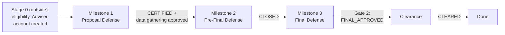

# PRD — PUP CpE Thesis Progress Monitoring System

**Compliance standard:** Simplified Technical English (ASD-STE100) at about 80%
**Marker `[CONFIRM]`:** A proposal from the drafter. It needs the owner's decision.

## Document control

| Item | Value |
| :---- | :---- |
| Product | PUP CpE Thesis Progress Monitoring System |
| Version | 2.2 draft |
| Date | 22 Nov 2026 |
| Owner | Nanashi |
| Program | PUP Graduate Computer Engineering (Master's and Doctoral) |
| Status | Draft for owner review |
| Replaces | `PUP_CpE_Thesis_Progress_System_PRD_v1.3.md` (now in `docs/stale/`). No product rule changed. |
| Companion files | `USERFLOW.md` (flows), `SITEMAP.md` (routes and screens), `DFD.md` (data flows), `ERD.md` (data model). All in `spec/`. |
| Governing sources | Unified Thesis Process v1.1 (process rules), Functional Requirements v1.1 (system behavior), Operational Flow, DFD and Sitemap v3.1 (DFD) |

**Rule for this file:** The PRD states goals, scope, constraints and decisions. The Functional Requirements hold the detail (FR, BR, NFR and AS IDs). If this file and the Functional Requirements disagree on system behavior, the Functional Requirements win. If they disagree on a process rule, the Unified Thesis Process wins.

---

## 1. Problem statement `[CONFIRM]`

The PUP CpE graduate thesis moves through three milestones (Proposal, Pre-Final, Final) and a clearance step. Students, Advisers, Panel Members and the Coordinator work from 13 TDW forms and written guidelines. The signed paper is the official record.

| No. | Problem | Who feels it |
| :---- | :---- | :---- |
| P1 | The steps, forms and signers are spread across many documents. A Student does not see the next step. | Student |
| P2 | Feedback is not tied to a manuscript version. Comments get lost between revisions. | Student, Adviser, Panel Member |
| P3 | Consultation records (TDW 03) are kept by hand. | Adviser, Student |
| P4 | People check the rules by hand: the 7-day notice, the manuscript lock, and the match between paper and file. | Coordinator |
| P5 | No one has one view of who is blocked and why. | Coordinator, Adviser |

## 2. Vision and goals

**Vision:** One place where every person sees the same status, the same file version and the next action.

| ID | Goal | Problems |
| :---- | :---- | :---- |
| G1 | Each Student always sees one next action. | P1 |
| G2 | Feedback stays tied to a manuscript version. | P2 |
| G3 | The system enforces the process rules. The signed paper stays the record. | P4 |
| G4 | The Coordinator verifies documents and closes stages from one place. | P4, P5 |
| G5 | Users get timely event emails and in-app notifications. | P1, P5 |
| G6 | The Adviser keeps consultation records without extra paperwork. | P3 |

**What the system is not:** the legal record, an e-signature tool, a grading system, an ethics, IPMO, RPO or copyright system, or a registrar system.

## 3. Users

| Role | Priority | Main needs | Portal | First screen |
| :---- | :---- | :---- | :---- | :---- |
| Student | Primary | Next action, version-based feedback, forms, schedule, results | `/student` | S1 Thesis tracker |
| Adviser | Primary | Review queue, endorsement, consultation log, advisee status | `/adviser` | A1 Advisees and action queue |
| Panel Member | Secondary | Manuscript access after appointment, Defense Day entry, threads at the Final Defense | `/panel` | P1 Assignments |
| Coordinator | Primary | Accounts, appointments, document checks, date confirmation, stage close | `/coordinator` | C1 Overview and action queue |

- Each account has one role (BR-03). An Adviser is never a Panel Member. The Coordinator is neither.
- Lead Panel Member and Panel Chair are designations for one Student. They are not roles.
- The Dean, the registrar and the outside offices (ethics, IPMO, RPO, copyright) are not users. They work on paper. The Coordinator records their results.

## 4. User stories

Each story maps to Functional Requirements. Every active FR maps to at least one story.

| ID | Story | FR |
| :---- | :---- | :---- |
| US-01 | As a Student, I want to see my status and next action, so that I know what to do. | TRK-01, TRK-05, WFL-12, WFL-13 |
| US-02 | As a Student, I want to upload manuscript versions and see feedback tied to each version. | REV-01, REV-02, REV-03, REV-05 |
| US-03 | As a Student, I want to reply to threads, tag what I fixed and mark a version Ready. | REV-06, REV-07, REV-08, REV-14 |
| US-04 | As a Student, I want to book consultations, including online ones with a meeting link. | SCH-01, SCH-02, SCH-03, SCH-04 |
| US-05 | As a Student, I want to pick a defense date from valid dates. | SCH-08, DEF-01 |
| US-06 | As a Student, I want to download prefilled forms and upload my signed scans. | DOC-01 to DOC-05, DOC-09, DOC-11, DEF-02 |
| US-07 | As a Student, I want to read my defense results and the Minutes. | DEF-11, DEF-12 |
| US-08 | As a Student, I want to complete clearance steps and see what is left. | CLR-01, CLR-02 |
| US-09 | As an Adviser, I want to review versions, post threads and endorse for committee review. | REV-04, REV-09, WFL-03, WFL-05, WFL-11 |
| US-10 | As an Adviser, I want to publish slots and keep the consultation log. | SCH-01, SCH-02, SCH-05, SCH-06 |
| US-11 | As an Adviser, I want to monitor my advisees. | TRK-02, TRK-06 |
| US-12 | As an Adviser, I want to endorse at Gate 1b and Gate 2 and complete my defense sheet. | WFL-04, WFL-07, DEF-05, DEF-06 |
| US-13 | As a Panel Member, I want to read the manuscript once I am appointed and my NDA is recorded. | CMT-05, REV-03, REV-15, TRK-03 |
| US-14 | As a Panel Member, I want to review and comment at committee review (Milestones 1 and 2). | REV-04, REV-11, WFL-04, WFL-05 |
| US-15 | As a Panel Member, I want to encode my evaluation on Defense Day and post threads at the Final Defense. | DEF-05, DEF-06, REV-12 |
| US-16 | As a Lead Panel Member or Panel Chair, I want to record the verdict. | DEF-07 |
| US-17 | As a Panel Member, I want to publish my defense availability. | SCH-07 |
| US-18 | As a Coordinator, I want to create accounts and manage users. | ACC-04 to ACC-07 |
| US-19 | As a Coordinator, I want to appoint committees and panels, and record substitutes. | CMT-01 to CMT-04, CMT-06 |
| US-20 | As a Coordinator, I want to verify documents and confirm the date and room. | DOC-06, DOC-07, DOC-08, DEF-03, DEF-04 |
| US-21 | As a Coordinator, I want to verify sheets, issue the Minutes and close the stage. | DEF-08 to DEF-10, WFL-06, WFL-08, WFL-09, REV-13 |
| US-22 | As a Coordinator, I want to track outside statuses and close clearance. | WFL-10, CLR-03, CLR-04 |
| US-23 | As a Coordinator, I want a program overview and CSV reports. | TRK-04, RPT-03 |
| US-24 | As a Coordinator, I want an audit trail of gate actions and returns. | RPT-01, RPT-02, WFL-14 |
| US-25 | As a Coordinator, I want to manage milestone templates and parameters. | TPL-01 to TPL-05 |
| US-26 | As any user, I want in-app and email notifications for events that need me. | NTF-01 to NTF-10 |
| US-27 | As any user, I want to search and save filters. | RPT-04 |
| US-28 | As any user, I want one read-only submission view after Gate 1b. | SUB-01 to SUB-05, DOC-10 |
| US-29 | As any user, I want to sign in and see only what my role allows. | ACC-01, ACC-02, ACC-03, ACC-08 |
| US-30 | As a Coordinator, I want the system to open milestones in order and keep one status for each. | WFL-01, WFL-02 |

## 5. Scope

### 5.1 In scope (107 active FRs)

| Module | Name | FRs | Must | Should | Could |
| :---- | :---- | :---- | :---- | :---- | :---- |
| ACC | Accounts and access | 8 | 7 | 1 | 0 |
| TPL | Templates and parameters | 5 | 3 | 2 | 0 |
| WFL | Workflow and gates | 14 | 13 | 1 | 0 |
| CMT | Committees and panels | 6 | 5 | 1 | 0 |
| REV | Manuscript and review | 14 | 9 | 5 | 0 |
| DOC | Documents and forms | 11 | 7 | 4 | 0 |
| SCH | Consultations and availability | 8 | 7 | 1 | 0 |
| DEF | Defense | 12 | 12 | 0 | 0 |
| CLR | Clearance | 4 | 4 | 0 | 0 |
| NTF | Notifications and email | 10 | 5 | 4 | 1 |
| TRK | Dashboards and tracking | 6 | 4 | 2 | 0 |
| RPT | Audit, reports and search | 4 | 1 | 3 | 0 |
| SUB | Shared submission view | 5 | 0 | 5 | 0 |
| | **Total** | **107** | **77** | **29** | **1** |

### 5.2 Out of scope and deferred

| Item | Status | Reason |
| :---- | :---- | :---- |
| E-signature | Out of scope | Paper stays the record (BR-01) |
| Subject grade and grade equivalent | Out of scope | Encoded in a separate grading system (BR-15) |
| Work by outside offices (ethics, IPMO, RPO, copyright, statistics, editing) | Out of scope | The system shows status only (BR-14) |
| Stage 0 (concept paper, Adviser appointment, units, comprehensive exam, enrollment) | Out of scope | The Coordinator creates the account after eligibility |
| GS Form 08 (Application for Graduation) | Out of scope | Not in the flow |
| News and announcement emails | Deferred | Other messaging apps do this better |
| Submission pre-check (NF-04, FR-REV-10) | **Paused** | The architecture needs more thought |
| AI features (FR-AIA-01 to 03) | Deferred | ADR-007 |
| Compare view (NF-02), print-match cover sheet (NF-05), Defense Day autosave and private notes (NF-16) | Not selected | |
| Calendar file download | Removed | Online consultations use a meeting link |

## 6. Core journey

The thesis runs through three milestones and clearance. Each milestone uses the same 14-step defense cycle. `USERFLOW.md` gives every flow in full.

| Cycle steps | What happens |
| :---- | :---- |
| 1 to 3 | The Student writes, consults, replies to threads and marks a commit Ready. |
| 4 | Gate 1a: the Adviser endorses for committee review. |
| 5 to 7 | The Coordinator appoints the committee or panel. Panel Members review. Gate 1b locks the manuscript. |
| 8 to 11 | The Student picks a date. The Coordinator checks documents and confirms the date. Printed copies arrive. |
| 12 to 14 | Defense Day. The verdict is recorded. The Coordinator verifies sheets, issues the Minutes and closes the stage. |

## 7. Key product rules

The full list is BR-01 to BR-21 in the Functional Requirements.

| ID | Rule |
| :---- | :---- |
| BR-01 | An in-system action shows intent. The wet-signed paper is the record. |
| BR-02 | Only the Coordinator sets CLOSED, CERTIFIED, FINAL_APPROVED and CLEARED. |
| BR-03 | One role per account. |
| BR-05 | Each reviewer resolves only their own threads. The Student replies. |
| BR-07 | The manuscript locks at Gate 1b. It unlocks when the defense closes. |
| BR-08 | A Panel Member opens the manuscript only after the appointment form and that member's NDA are recorded. |
| BR-09 | The defense date is at least 7 days after Gate 1b. Printed copies are due 7 days before. |
| BR-12 | A paper mismatch does not stop a defense. The stage cannot close until it is fixed. |
| BR-17 | Flags never block an action. |
| BR-18 | Every disabled action shows its reason. |
| BR-19 | Commits, locked scans and audit records are never changed or deleted. |
| BR-20 | The Final Panel comments from the scheduled start of the Final Defense until Gate 2. |

## 8. Release phases (approved 22 Nov 2026, D-22)

| Phase | Name | Content | Exit test |
| :---- | :---- | :---- | :---- |
| 0 | Technical spike | Neon sign-in, signed uploads, PDF view with range requests, direct hash check, Vercel deploy, daily cron, one email send, real file sizes from the uploaded repository | The spike answers R12 and R13 and settles AS-11 |
| 1 | Foundation and Milestone 1 | ACC, TPL, WFL (Milestone 1), CMT, REV core, DOC core, SCH core, DEF (Milestone 1), TRK dashboards, RPT-01 (audit log), NTF-01 (in-app) | One Student completes the Proposal Defense and reaches CERTIFIED |
| 2 | Milestone 2 and email | IPMO status, TDW 09 and 10, revision items (REV-13), event emails (NTF-02 to NTF-09) | One Student completes the Pre-Final Defense |
| 3 | Milestone 3 and clearance | Defense Day threads (REV-12), Gate 2, CLR, shared submission view (SUB), dossier export | One Student reaches CLEARED |
| 4 | Enhancements | Change notes, review queue, form pack, forms guide, key dates, pacing flags, consultation prep, comment-response export, audit viewer, reports, template versioning, search | Chosen by value |

- Phases follow the milestones. This matches the owner's milestone-by-milestone way of working.
- The paused pre-check is not in any phase.

## 9. Success measures `[CONFIRM]`

Baselines are not known yet. The owner sets the targets (open item).

| ID | Measure | Goal | How to measure | Target |
| :---- | :---- | :---- | :---- | :---- |
| M1 | Share of pilot Students who name their next action correctly from S1 | G1 | Short task test | To be set |
| M2 | Share of feedback threads tied to a version | G2 | System data | 100% by design |
| M3 | Rule violations that get through (date under 7 days, upload after lock, gate with open threads) | G3 | Test cases and audit log | 0 |
| M4 | Coordinator time to verify one defense package | G4 | Timed trial against the paper method | To be set |
| M5 | Returns caused by missing or wrong documents | G4 | Audit log | Down from baseline |
| M6 | Events with a notification sent within the set time | G5 | Email log | To be set |
| M7 | Pilot usability score (SUS) | All | Questionnaire after a pilot | To be set |

## 10. Constraints

| Constraint | Source |
| :---- | :---- |
| Signed paper is the official record. Wet signatures. | BR-01 |
| The physical copy must match the uploaded file. | BR-12, FR-DEF-04 |
| Master's and Doctoral programs are both in scope. | Unified Thesis Process |
| One third-party feature service only: mail. Hosting, database, auth and files are infrastructure. | NFR-06 |
| All dates and times use Philippine Standard Time (UTC+8). | NFR-11 |
| The official Graduate School form files are needed for the form pack. | AS-08 |
| Free tiers only for every platform. | D-14 |
| The repository sits on a personal GitHub account because of Vercel Hobby. | D-15 |

## 11. Quality and technology

### 11.1 Quality summary (NFR-01 to NFR-13)

| Area | Requirement |
| :---- | :---- |
| Security | The server checks access on every read and write (NFR-01). |
| Integrity | SHA-256 hash for each commit and locked scan (NFR-02). Append-only audit log (NFR-03). |
| Reliability | An email failure never blocks a step (NFR-05). |
| Usability | One landing screen per role. Every disabled action shows its reason (NFR-04, BR-18). |
| Devices | Laptop and tablet screen widths for the Defense Day page and the viewer (NFR-09). |
| Files | PDF manuscript. PDF or image scans. Proposed limit 50 MB (NFR-10, AS-11 open). |
| Privacy | Emails and logs hold the least personal data. Retention period to be set (NFR-07). |
| Performance and availability | Targets are not set yet (NFR-08). |

### 11.2 Technology stack (free tiers only, confirmed by the owner)

| Layer | Choice | Free-tier note |
| :---- | :---- | :---- |
| Hosting | Vercel Hobby (for now) | Non-commercial personal use only |
| Framework | Next.js 16 (App Router), React 19, TypeScript (strict), Node.js 20.9 or newer | Free |
| Database | Neon Postgres | 1 GB per project. 100 CU-hours per month. |
| Authentication | Neon Auth (managed Better Auth), email and password | Up to 60,000 monthly users |
| File storage | Neon Object Storage (S3-style, Singapore region) with signed links | 5 GB per project |
| Email | Resend Free + React Email | 3,000 per month, 100 per day |
| Scheduled jobs | Vercel Cron | One run per day |
| UI | Tailwind CSS, shadcn/ui, Lucide, TanStack Table | Free |
| Forms | React Hook Form + Zod | Free |
| PDF | `react-pdf` (view), @pdfme/pdf-lib (fill forms), a zip library | Free |
| Dates | `date-fns`, `date-fns-tz` (Asia/Manila) | Free |
| Search | PostgreSQL full-text search | Free |
| Tests and CI | Vitest, Playwright, GitHub Actions | Free allowance |

**Rejected:** Supabase, Vercel Blob, Cloudflare R2, Inngest or Trigger.dev, Tremor and Recharts, AI libraries, `pgvector`, Langfuse.

### 11.3 Design rules from the stack

| No. | Rule |
| :---- | :---- |
| 1 | The browser uploads files directly to file storage with signed links. The server never receives file bytes (NFR-12). |
| 2 | The viewer reads PDFs through short-lived signed links. It uses range requests to load only the pages in view. |
| 3 | The browser computes the SHA-256 hash before upload. The server checks it after upload (NFR-02). |
| 4 | The browser never touches the database. One server-side data layer checks access for every read and write. Tests cover it (NFR-01). |
| 5 | Each commit uses a write-once file key. The system never issues a delete link. The audit table accepts inserts only (BR-19). |
| 6 | Event emails send at once from the server. One daily job sends reminders and digests. |
| 7 | The daily job runs in UTC at about 00:00 (08:00 Philippine time) (NFR-11). |

### 11.4 Free-tier limits and capacity

Limits were checked on 18 Nov 2026. Check them again before release (R9).

| Platform | Limits that matter |
| :---- | :---- |
| Vercel Hobby | Non-commercial use. Cron once per day. Request and response bodies up to 4.5 MB. |
| Neon Free | 1 GB database. 5 GB file storage. 100 CU-hours. 5 GB public network transfer per month. No card. |
| Resend Free | 3,000 emails per month and 100 per day |

**Capacity (5 GB of files).** All inputs except the manuscript length (100 pages or more) are placeholders (AS-11, AS-12 open).

| Case | Storage per Student, full lifecycle | Full lifecycles in 5 GB |
| :---- | :---- | :---- |
| Low (0.10 MB per page, 4 commits) | about 210 MB | about 23 |
| Typical (0.15 MB per page, 5 commits) | about 315 MB | about 15 |
| High (0.25 MB per page, 8 commits) | about 690 MB | about 7 |

The free tier gives pilot scale: a few cohorts, not the whole program.

## 12. Risks and dependencies `[CONFIRM]`

| ID | Risk or dependency | Mitigation |
| :---- | :---- | :---- |
| R1 | Graduate School answers are pending (Section 15). | Each question has a default. Rules sit in template parameters. |
| R2 | Official form files are not yet in hand. | Get the files before Phase 2. |
| R3 | Faculty may not use the Defense Day page. | The Coordinator verifies against the paper sheet (BR-12). |
| R4 | One role per account does not match real faculty practice. | Keep two pools. Review with the Program Chair. |
| R5 | Scope is large (107 FRs). | Four phases. Milestone-based slices. |
| R6 | The mail service fails. | The in-app bell still records every event (NFR-05). |
| R7 | Residency limit values are unverified. | Warning only. Values sit in the template. |
| R8 | Personal data and manuscripts need care. | Link-only emails. Set the retention period (NFR-07). |
| R9 | Free-tier limits can change. | Check limits before release. Keep the stack portable. |
| R10 | Vercel Hobby is for non-commercial personal use. | Host on Vercel for now. Review other free hosts later. |
| R11 | Free storage is 5 GB. | Pilot scope. Share identical files. Review sizes after the spike. |
| R12 | The file store is a new service. | Technical spike before Phase 1. |
| R13 | Downloads may count against the 5 GB transfer limit. | Test in the spike (AS-13). |
| R14 | One vendor holds the database, auth and files. | Standard Postgres, S3-style API and open-source auth keep exit paths open. |
| R15 | Cron runs once per day. | Accept daily reminders and digests. |

## 13. Decision log

| ID | Decision | Notes |
| :---- | :---- | :---- |
| D-01 | Two-layer approval. Paper is the record. | No e-signature |
| D-02 | Stage 0 is outside the system. The Coordinator creates the account after eligibility. | |
| D-03 | One role per account. | Restores ADR-001 |
| D-04 | The panel role is "Panel Member". Designations: Lead Panel Member, Panel Chair. | Old term dropped |
| D-05 | Only the Coordinator closes a stage. | |
| D-06 | Three comment contexts: iteration, committee review, Defense Day. | |
| D-07 | At the Final Defense, Panel Members post threads from the scheduled start to Gate 2. Threads are the revision tracker at the Final. | Option A |
| D-08 | Revision items from the Minutes are used at Proposal and Pre-Final only. | |
| D-09 | Shared submission view opens at Gate 1b. Four routes, one screen. | |
| D-10 | Event emails are automatic with fixed templates and links only. News emails are deferred. | |
| D-11 | Online consultations carry a meeting link. No calendar file. | |
| D-12 | The pre-check (NF-04) is paused. | |
| D-13 | Times use Philippine Standard Time. | |
| D-14 | Free tiers only for every platform. | Owner |
| D-15 | Hosting on Vercel Hobby for now. | Owner |
| D-16 | Neon Free for database, auth and file storage. | Owner. Replaces Supabase. |
| D-17 | Resend Free for email. | |
| D-18 | The browser uploads files directly with signed links. | 4.5 MB request limit |
| D-19 | One daily job. Digests group per day. | Cron limit |
| D-20 | File limit 50 MB. | Proposed |
| D-21 | RETURNED goes back to DRAFT. The Student sees the written reason. | Owner, 22 Nov 2026 (FR-WFL-02) |
| D-22 | Release phases 0 to 4 in Section 8 are approved. Work starts with Phase 0. | Owner, 22 Nov 2026. Build plan: `spec/BUILD_PLAN.md` |

## 14. Open items

**Owner items (agents do not decide these):** AS-11 and AS-12 (file sizes, page counts, commits per milestone), AS-13 (transfer limit), the long-term hosting choice (Q7), the success targets (Q3), the main reader of this PRD (Q1), the reviewer wait threshold (Q4).

| ID | Question | Default used |
| :---- | :---- | :---- |
| Q1 | Who is the main reader of this PRD? | All readers |
| Q2 | Can a faculty member upload their own signed scan? | Student and Coordinator only |
| Q3 | What are the success targets? | Not set |
| Q4 | What is the "commit waiting too long" threshold? | Not set |
| Q5 | How many commits does a milestone usually have? | 5 |
| Q6 | What are the real sizes and page counts of the TDW forms? | 90 MB per Student for forms and evidence |
| Q7 | Which hosting will the system use long term? | Vercel Hobby for now |
| Q8 | How long does the system keep emails, notifications and logs? No Graduate School source sets it. Ask the PUP Data Protection Officer (RA 10173). | Keep all rows. No purge. |

**Graduate School questions** (G3 to G25, PK2) keep the defaults in the Unified Thesis Process, Part 5.2. None blocks the work.

## 15. Document map

| Document | Role |
| :---- | :---- |
| `spec/PRD.md` (this file) | Goals, scope, constraints, decisions |
| `spec/USERFLOW.md` | How each person moves through the process |
| `spec/SITEMAP.md` | Routes, navigation, screens and access rules |
| `spec/DFD.md` | Data flows, stores and trust boundaries |
| `spec/ERD.md` | Data model, invariants and state machines |
| `spec/BUILD_PLAN.md` | Phases, epics and tasks for the build |
| `docs/PUP_CpE_Thesis_Progress_System_Unified_Thesis_Process_v1.1.md` | Source of truth for process rules |
| `docs/PUP_CpE_Thesis_Progress_System_Functional_Requirements_v1.1.md` | Source of truth for system behavior (FR, BR, NFR, AS) |
| `docs/PUP_CpE_Thesis_Progress_System_Operational_Flow_DFD_Sitemap_v3.1.md` | Operational flow and the first DFD |
| `AGENTS.md` | Rules for AI coding agents |
| `DESIGN.md` (repository root) | Design system |
| Acceptance criteria (tests per FR) | Planned |

## 16. Change log

| Version | Date | Change |
| :---- | :---- | :---- |
| 1.0 to 1.3 draft | 18 to 22 Nov 2026 | See `docs/stale/PUP_CpE_Thesis_Progress_System_PRD_v1.3.md` |
| 2.0 draft | 22 Nov 2026 | One PRD file. Adds the companion files `USERFLOW.md` and `SITEMAP.md`. Adds BR-05, BR-08, BR-18, BR-19 and BR-20 to the key rules. Shortens the capacity table. Removes the self-review and the template notes (kept in v1.3). Adds D-21 (RETURNED goes back to DRAFT). |
| 2.1 draft | 22 Nov 2026 | Source check against the Guidelines and TDW forms: BR-21 (`[CONFIRM]`), Q8 (retention), G24 and G25. No product rule invented. |
| 2.2 draft | 22 Nov 2026 | Section 8 approved (D-22). Adds `BUILD_PLAN.md` to the document map. |
