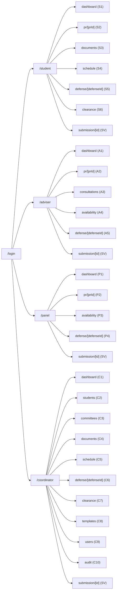

# SITEMAP — PUP CpE Thesis Progress Monitoring System

**Compliance standard:** Simplified Technical English (ASD-STE100) at about 80%
**Version:** 1.0 draft · 22 Nov 2026
**Derived from:** Unified Thesis Process v1.1 (Parts 3 and 4), Operational Flow, DFD and Sitemap v3.1 (Part 4), Functional Requirements v1.1
**Rule for this file:** This file holds no new rule. If it disagrees with the Functional Requirements, the Functional Requirements win. Correct this file.
**Companion files:** `PRD.md`, `USERFLOW.md`, `DFD.md`, `ERD.md`

---

## 1. Summary

| Item | Value |
| :---- | :---- |
| Portals | 4: `/student`, `/adviser`, `/panel`, `/coordinator` |
| Routes | 30: 1 public, 7 Student, 6 Adviser, 5 Panel Member, 11 Coordinator |
| Screens | Sign in, 25 role screens (S1 to S6, A1 to A5, P1 to P4, C1 to C10), and 1 shared submission view (SV) on 4 routes |
| Page-frame panels | 3, with no route: notification center, preferences, search |

## 2. Global access rules

| No. | Rule | Source |
| :---- | :---- | :---- |
| 1 | Each route is open only to its role. Other access shows an **Access Denied** banner. | FR-ACC-02 |
| 2 | The server checks the data scope on every read and write. The screen is not enough. | FR-ACC-03, NFR-01 |
| 3 | A Student sees only their own data. An Adviser sees only their own advisees. A Panel Member sees only assigned Students. | BR-04 |
| 4 | The manuscript is locked to a Panel Member until the appointment form and that member's NDA are recorded. The access ends when the approved revised copy is submitted (`[CONFIRM]` G25). | BR-08, BR-21 |
| 5 | A Defense Day page opens only at the scheduled start. | BR-10 |
| 6 | Defense results show only after the Coordinator verifies the sheets. | BR-11 |
| 7 | Clearance screens appear from Milestone 3. | FR-CLR-01 |
| 8 | The shared submission view opens at Gate 1b. | FR-SUB-01 |
| 9 | At the Final Defense, Panel Members comment from the scheduled start until Gate 2. | BR-20 |
| 10 | The meeting link of an online consultation shows only to the Adviser and the booked Student. | FR-SCH-03 |
| 11 | Every disabled action shows its reason. | BR-18 |

## 3. Route table (30 routes)

| Route | Role | Screen | ID | Main FRs |
| :---- | :---- | :---- | :---- | :---- |
| `/login` | Public | Sign in | — | ACC-01, ACC-08 |
| `/student/dashboard` | Student | Thesis tracker | S1 | TRK-01, TRK-05, WFL-12 |
| `/student/pr/[prId]` | Student | Manuscript workspace | S2 | REV-01 to REV-08, REV-14 |
| `/student/documents` | Student | Deliverables and uploads | S3 | DOC-01 to DOC-05, DOC-09, DOC-11 |
| `/student/schedule` | Student | Consultations and defense calendar | S4 | SCH-02 to SCH-04, SCH-08, DEF-01 |
| `/student/defense/[defenseId]` | Student | Defense results | S5 | DEF-11, DEF-12 |
| `/student/clearance` | Student | Post-defense clearance | S6 | CLR-01, CLR-02 |
| `/student/submission/[id]` | Student | Shared submission view | SV | SUB-01 to SUB-05 |
| `/adviser/dashboard` | Adviser | Advisee roster and action queue | A1 | TRK-02, TRK-06, REV-09, WFL-11 |
| `/adviser/pr/[prId]` | Adviser | Review and gates | A2 | REV-04, WFL-03, WFL-04, WFL-07 |
| `/adviser/consultations` | Adviser | Consultation log (TDW 03) | A3 | SCH-05, SCH-06 |
| `/adviser/availability` | Adviser | Slots and requests | A4 | SCH-01, SCH-02, SCH-07 |
| `/adviser/defense/[defenseId]` | Adviser | Defense Day page | A5 | DEF-05, DEF-06 |
| `/adviser/submission/[id]` | Adviser | Shared submission view | SV | SUB-01 to SUB-05 |
| `/panel/dashboard` | Panel Member | Assignments | P1 | TRK-03, REV-09 |
| `/panel/pr/[prId]` | Panel Member | Manuscript reader and gates | P2 | REV-04, REV-11, REV-15, WFL-04, WFL-07 |
| `/panel/availability` | Panel Member | Defense availability | P3 | SCH-07 |
| `/panel/defense/[defenseId]` | Panel Member | Defense Day page and verdict | P4 | DEF-05 to DEF-07, REV-12 |
| `/panel/submission/[id]` | Panel Member | Shared submission view | SV | SUB-01 to SUB-05 |
| `/coordinator/dashboard` | Coordinator | Overview and action queue | C1 | TRK-04, TRK-05, TRK-06, RPT-03 |
| `/coordinator/students` | Coordinator | Accounts and eligibility data | C2 | ACC-04, ACC-07 |
| `/coordinator/committees` | Coordinator | Committees, panels, NDAs | C3 | CMT-01 to CMT-06 |
| `/coordinator/documents` | Coordinator | Compliance and verification | C4 | DOC-06 to DOC-08, WFL-10 |
| `/coordinator/schedule` | Coordinator | Date confirmation, printed copies | C5 | DEF-03, DEF-04 |
| `/coordinator/defense/[defenseId]` | Coordinator | Sheets, Minutes, close | C6 | DEF-08 to DEF-10, WFL-06, REV-13 |
| `/coordinator/clearance` | Coordinator | Clearance and Gate 2 record | C7 | CLR-01 to CLR-04, WFL-07, WFL-10 |
| `/coordinator/templates` | Coordinator | Milestone templates and parameters | C8 | TPL-01 to TPL-05, NTF-10 |
| `/coordinator/users` | Coordinator | Users and roles | C9 | ACC-05, ACC-06 |
| `/coordinator/audit` | Coordinator | Audit trail and CSV export | C10 | RPT-01, RPT-02, NTF-07 |
| `/coordinator/submission/[id]` | Coordinator | Shared submission view and dossier export | SV | SUB-01 to SUB-05, DOC-10 |

## 4. Sitemap tree

## 5. Navigation by role

| Role | Landing route | Sidebar items (in order) |
| :---- | :---- | :---- |
| Student | `/student/dashboard` | Thesis Tracker, Manuscript, Documents, Schedule, Defense Results, Clearance, Submission |
| Adviser | `/adviser/dashboard` | Advisees, Review Queue, Consultations, Availability, Defense Day, Submission |
| Panel Member | `/panel/dashboard` | Assignments, Manuscript, Availability, Defense Day, Submission |
| Coordinator | `/coordinator/dashboard` | Overview, Students, Committees, Documents, Schedule, Defense, Clearance, Templates, Users, Audit, Submission |

**When a sidebar item shows:**
- Clearance (Student) shows from Milestone 3.
- Defense Results (Student) shows after the Coordinator verifies the sheets.
- Submission shows after Gate 1b.
- Defense Day (Adviser, Panel Member) opens at the scheduled start. Before that, it shows the date and a countdown.

## 6. Shared layout

| Component | What it shows or does |
| :---- | :---- |
| App shell | Left sidebar (240 px) with the role's navigation. Top bar with breadcrumb, milestone pill, status pill, notification bell and user menu. |
| Milestone stepper | Three milestones and clearance. Each shows Completed, Active or Locked. |
| Next-action card | One sentence that names the next step and who acts. One primary button. |
| Readiness checklist | Each required item with a state chip, and the reason if it blocks. |
| Status pill | The milestone status. Same colors on every screen. |
| Document chip | The document state: Not started, Prepared, Scan uploaded, Locked as submitted, Physical received, Verified, Mismatch, Returned. |
| Outside-status chip | Ethics, IPMO, RPO or copyright status. Read only except for the Coordinator. |
| Manuscript workspace | Split screen. Left: PDF viewer with commit selector. Right: thread feed. Bottom: role actions. |
| Return dialog | A required reason. The receiver sees it. |
| Gate dialog | Names the gate, lists what it unlocks, asks for confirmation. |
| Blocked-action note | Every disabled button shows why. |

**Visual guidance:** Unified Thesis Process v1.1, Section 1.7. Every screen answers three questions: where am I, what blocks me, what can I do now.

## 7. Screen inventory

### 7.1 Student

| ID | Purpose | Regions | Key rules |
| :---- | :---- | :---- | :---- |
| S1 | Show where the thesis stands and the next step | Identity card, milestone stepper, next-action card, readiness checklist, outside-status chips, defense card, key dates panel | The residency indicator is a warning only (BR-17). The defense card shows after date confirmation. |
| S2 | Write, upload versions, answer comments | Header with commit selector and Mark Ready, PDF viewer, thread feed (All, Open, Resolved), upload bar, change note and Addressed tag, comment-response export, lock banner | The Student replies but cannot resolve (BR-05). An upload clears Ready and marks older open threads Outdated. Uploads are blocked after Gate 1b (BR-07). |
| S3 | Show deliverables and collect uploads | Deliverables table, prefilled form download, form pack, scan and OR upload, read-only rows (Minutes, sheets, Certification), forms guide tab, History tab | A scan locks on upload. A replacement needs a Return (BR-19). |
| S4 | Book consultations and choose the defense date | Consultation tab (slots, agenda, linked threads, meeting link), defense date tab (calendar), Propose date | The defense date tab is locked until Gate 1b. Dates under 7 days after Gate 1b are greyed out with the reason (BR-09). |
| S5 | Show results after verification | Verdict banner, member results, Minutes, attempt history, next steps | Shows after verification (BR-11). No grade equivalent (BR-15). |
| S6 | Track clearance | Status list (IPMO, RPO, Gate 2, copyright), final copy receipt, evidence uploads, exit checklist | The Coordinator verifies each item. |

### 7.2 Adviser

| ID | Purpose | Regions | Key rules |
| :---- | :---- | :---- | :---- |
| A1 | Action queue and roster | Action queue (Gate 1a, 1b, 2, log entries, TDW 03, data gathering), review queue with days waiting, advisee roster with pacing flags | Approve data gathering after CERTIFIED (FR-WFL-11). Flags are information only. |
| A2 | Review and gates | Shared workspace, gate button, Return, revision-check box (Milestone 3, Gate 1b) | A gate button is enabled only when its conditions are met. The blocker shows beside it. |
| A3 | Consultation log | Log table, TDW 03 form view, recommendations, signed scan upload | The signed TDW 03 is needed before date confirmation. |
| A4 | Availability | Publish slot (Consultation or Defense, In person or Online, meeting link), requests | Confirm or Decline a request. Slots can recur. |
| A5 | Defense Day | Member entry form (Proposal, Pre-Final), read-only results (Final) | Opens at the scheduled start. Editable until verified. No TDW 13 sheet for the Adviser. |

### 7.3 Panel Member

| ID | Purpose | Regions | Key rules |
| :---- | :---- | :---- | :---- |
| P1 | Assignments | Assignment list (Student, milestone, designation, access status, action required), review queue, defense schedule | Access shows Locked until the form and the NDA are recorded (BR-08). |
| P2 | Manuscript workspace | Shared workspace, Final Panel read-only banner, bottom bar (Gate 1b, Gate 2, Return) | Before the Final Defense starts, the Final Panel reads only (FR-REV-15). From the start to Gate 2, Panel Members post and resolve their own threads. |
| P3 | Availability | Publish defense slot | — |
| P4 | Defense Day and verdict | Header with substitute banner, My evaluation tab, Manuscript and comments tab (Final only), Verdict tab | The Verdict tab is for the Lead Panel Member or Panel Chair only, on or after the defense date (FR-DEF-07). |

### 7.4 Coordinator

| ID | Purpose | Regions | Key rules |
| :---- | :---- | :---- | :---- |
| C1 | Overview | KPI strip, grouped action queue, Student table, key dates, pacing flags, CSV exports | Each count opens its queue. |
| C2 | Accounts | Create-account form, Student list | Create an account only after eligibility. The system creates the Thesis Instance and Milestone 1. |
| C3 | Committees | Appointment board, member status, paper (TDW 06 or 11, NDAs), substitute | The Adviser pool and the Panel Member pool are separate. A declined seat needs a replacement. |
| C4 | Compliance | Compliance checklist, scan viewer, outside-status setters, forms guide tab, Return dialog | A Return reason is compliance or eligibility only (BR-13). |
| C5 | Schedule | Date requests, printed copies | Confirm is blocked until the checklist is complete (FR-DOC-08). Late copies show a warning. |
| C6 | Defense | Entry tracker, sheets, verdict, Minutes, revision items, Close, Certification | Close needs every sheet verified and the Minutes issued. |
| C7 | Clearance | Outside-status selectors, Gate 2 tracker, evidence, Close | CLEARED needs every item verified. |
| C8 | Templates | Milestone templates, parameters, target dates, email wording | A change makes a new template version. Running instances keep their version. |
| C9 | Users | User table, role, email address | One role per account (BR-03). |
| C10 | Audit | Filters (Student, actor, action, date), result table, CSV export | Read only. Includes email events. |

### 7.5 Shared submission view (SV)

| Purpose | Regions | Key rules |
| :---- | :---- | :---- |
| One read-only view of one Milestone Instance | Locked manuscript viewer, gate record, document checklist, defense date and room or link, thread counts, document comments, Minutes after close, dossier export (Coordinator only) | Opens at Gate 1b. Panel Members still need the form and the NDA. No gate or edit action. Links to the user's own workspace. |

## 8. Page-frame panels (no route)

| Panel | Opened from | Purpose |
| :---- | :---- | :---- |
| Notification center | Bell in the top bar | In-app events with read and unread state (FR-NTF-01) |
| Preferences | User menu | Turn off reminders and digests (FR-NTF-05, FR-NTF-09) |
| Search and saved filters | Top bar | Find Students, documents and threads the user can access (FR-RPT-04) |

## 9. Blocked-action messages

| Action | Screen | Blocked when | Message |
| :---- | :---- | :---- | :---- |
| Upload a commit, Mark Ready | S2 | The manuscript is locked | Locked until the defense is closed. |
| Gate 1a | A2 | The Adviser has open threads | You have open threads. Resolve them first. |
| Gate 1a (Milestone 2) | A2 | IPMO is not PASSED | The IPMO check has not passed. |
| Gate 1b | A2, P2 | The member has open threads | You have open threads. Resolve them first. |
| Gate 1b (Milestone 3) | A2, P2 | Revisions not accepted | Accept the Pre-Final revisions first. |
| Choose a date | S4 | Gate 1b is not done | Locked until Gate 1b. |
| Confirm date and room | C5 | The checklist is incomplete | An item is missing. The screen names it. |
| Defense Day page | A5, P4 | The start time has not come | Opens at the scheduled start. |
| Record the verdict | P4 | The defense date has not come | Allowed on or after the defense date. |
| Gate 2 | A2, P2 | IPMO or RPO not complete | A clearance item is incomplete. |
| Gate 2 | A2, P2 | The member has open threads | You have open threads. Resolve them first. |
| Post a Defense Day thread | P2, P4 | The Final Defense has not started | Opens at the scheduled start. |
| Post a Defense Day thread | P2, P4 | Gate 2 is passed | The comment window is closed. |
| Close a stage | C6, C7 | A sheet or item is not verified | A sheet is not verified. |

## 10. Prototype mapping

The clickable prototype is in `design/stitch/document-ingestion-processor/`. Each screen ID above has one file in `screens/` (for example `screens/student/s1_dashboard.html`). The prototype is a secondary source. If it differs from this file, this file wins.
