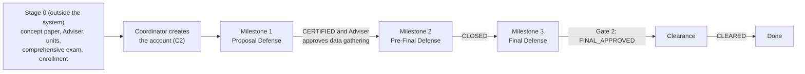
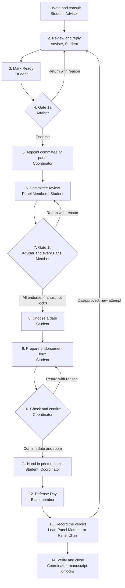
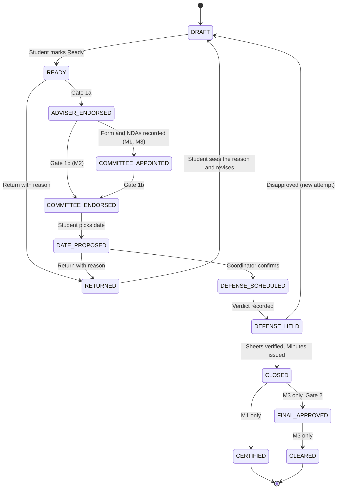
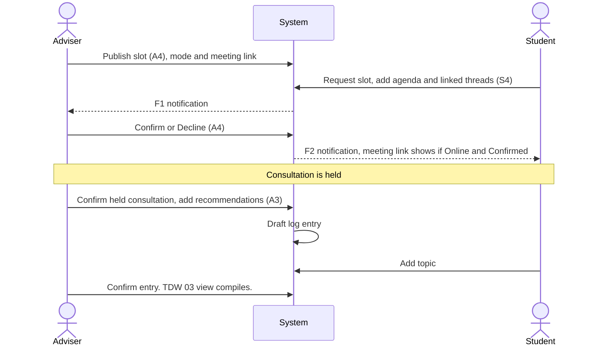
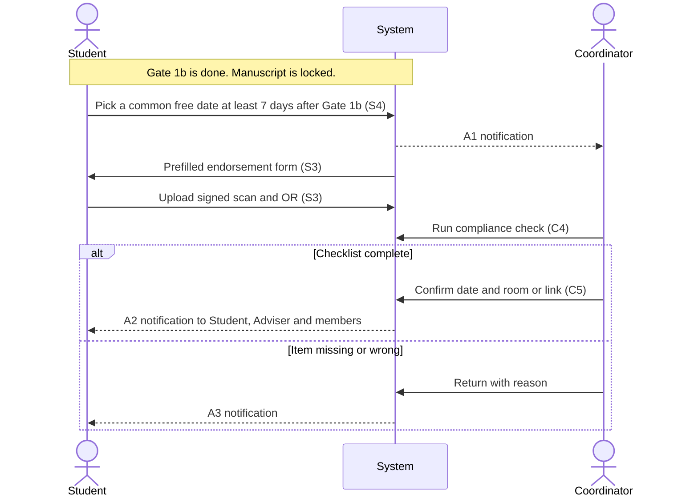
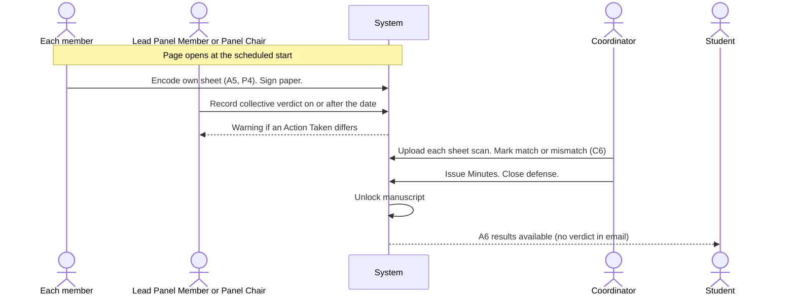

# USERFLOW — PUP CpE Thesis Progress Monitoring System

**Compliance standard:** Simplified Technical English (ASD-STE100) at about 80%
**Version:** 1.0 draft · 22 Nov 2026
**Derived from:** Unified Thesis Process v1.1 (Part 2), Operational Flow, DFD and Sitemap v3.1 (Part 2), Functional Requirements v1.1
**Rule for this file:** This file holds no new rule. If it disagrees with the Unified Thesis Process on a process rule, the Unified Thesis Process wins. If it disagrees with the Functional Requirements on system behavior, the Functional Requirements win. Correct this file.
**Companion files:** `PRD.md`, `DFD.md`, `ERD.md`, `SITEMAP.md` (screen IDs such as S1 and C5 are defined there)

---

## 1. The journey

| Milestone | Manuscript | Key forms | Ends when |
| :---- | :---- | :---- | :---- |
| 1. Proposal Defense | Chapters 1 to 3 | TDW 03, 05, 06, 07, 08 | CERTIFIED and the Adviser approves data gathering |
| 2. Pre-Final Defense | Chapters 1 to 5 | TDW 03, 09, 10 | CLOSED |
| 3. Final Defense and Clearance | Revised full manuscript | TDW 03, 11, 12, 13 | CLEARED |

## 2. The defense cycle (14 steps, every milestone)

| No. | Step | Actor | Screen | Rule |
| :---- | :---- | :---- | :---- | :---- |
| 1 | Write and consult | Student, Adviser | S2, S4, A3, A4 | The Student uploads commits. The Student books slots and lists an agenda. The system drafts a log entry when the Adviser confirms a held consultation. No minimum count (BR-16). |
| 2 | Review and reply | Adviser, Student | A2, S2 | Threads are tied to a commit. A newer commit marks older open threads Outdated. Only the author resolves a thread (BR-05). |
| 3 | Mark Ready | Student | S2 | One commit at a time. A new commit clears the mark. |
| 4 | **Gate 1a** | Adviser | A2 | Endorse or Return. Blocked while the Adviser has open threads. Milestone 2: blocked until IPMO PASSED. |
| 5 | Appoint | Coordinator | C3 | Record the appointment form and the NDAs. Each member gets access when the form and that member's NDA are recorded (BR-08). Milestone 2 has no new appointment. |
| 6 | Committee review | Panel Members, Student | P2, S2 | Panel Members post threads. The Student replies and uploads commits. |
| 7 | **Gate 1b** | Adviser, each Panel Member | A2, P2 | Each member's own threads resolved. All endorse. Milestone 3: each member accepts the Pre-Final revisions. The manuscript **locks** (BR-07). |
| 8 | Choose a date | Student | S4 | Only dates when all required members are free. Not earlier than 7 days after Gate 1b (BR-09). |
| 9 | Prepare the endorsement form | Student | S3 | The system prefills the form with the date. The Student collects paper signatures and uploads the scan and the OR. |
| 10 | Check and confirm | Coordinator | C4, C5 | The compliance check must be complete. Confirm date and room or link, or Return. |
| 11 | Printed copies | Student, Coordinator | C5 | Due at least 7 days before the defense. The Coordinator matches them against the locked manuscript. |
| 12 | Defense Day | Each member | A5, P4 | The page opens at the scheduled start. Each member encodes their own sheet and signs the paper. Final Defense: Panel Members can also post threads. |
| 13 | Record the verdict | Lead Panel Member or Panel Chair | P4 | On or after the defense date. A warning shows if a member's Action Taken differs. |
| 14 | Verify and close | Coordinator | C6 | Upload each sheet scan and check it. Check printed documents. Issue the Minutes. Close. The manuscript unlocks. |

## 3. What changes in each milestone

| Item | Milestone 1: Proposal | Milestone 2: Pre-Final | Milestone 3: Final |
| :---- | :---- | :---- | :---- |
| Extra condition at Gate 1a | None | IPMO PASSED | None |
| Appointment | Evaluation Committee: TDW 06, NDA (TDW 05) | None. NDA carries over. | Final Panel: TDW 11, new NDA |
| Before date confirmation | Ethics APPROVED | — | — |
| Extra at Gate 1b | — | — | Pre-Final revisions accepted |
| Endorsement form | TDW 07 | TDW 09 | TDW 12 |
| Evaluation sheet | TDW 08 (rubric). Adviser included. | TDW 10 (comments only). Adviser included. | TDW 13 (rubric). Final Panel only. |
| Verdict by | Lead Panel Member | Lead Panel Member | Panel Chair |
| Revision tracking | Revision items from the Minutes | Revision items from the Minutes | Defense Day threads |
| After the defense | Certification, then data gathering approval | Milestone 3 opens | Clearance |

## 4. Milestone status

- Only the Coordinator sets CLOSED, CERTIFIED, FINAL_APPROVED and CLEARED (BR-02).
- A Return always has a written reason. A Coordinator Return is for compliance or eligibility only (BR-13).
- The system keeps every attempt in the history (FR-WFL-09).
- RETURNED goes back to DRAFT. The Student sees the written reason (FR-WFL-02, D-21).

## 5. Flows by role

### 5.1 Student

| Step | Action | Screen | Done when |
| :---- | :---- | :---- | :---- |
| 1 | Sign in. Read the next-action card. | `/login`, S1 | The next step is clear |
| 2 | Upload a commit. Add a change note. Tag the threads it addresses. | S2 | The commit shows as the latest version |
| 3 | Book a consultation. Add an agenda and linked threads. | S4 | The slot is Confirmed |
| 4 | Reply to threads. Upload new commits. | S2 | Each thread has a reply or a fix |
| 5 | Mark Ready. | S2 | Status READY |
| 6 | After Gate 1b, choose a date. | S4 | Status DATE_PROPOSED |
| 7 | Download the prefilled endorsement form. Collect signatures. Upload the scan and the OR. | S3 | Both show "Scan uploaded" |
| 8 | Hand in printed copies at least 7 days before the defense. | S1 (defense card) | The Coordinator marks them received |
| 9 | Attend the defense. Read the result after verification. | S5 | Results visible |
| 10 | Revise. Milestone 3: reply to Defense Day threads. | S2 | Revisions accepted or threads resolved |
| 11 | Milestone 3: upload clearance evidence. | S6 | Status CLEARED |

### 5.2 Adviser

| Step | Action | Screen | Done when |
| :---- | :---- | :---- | :---- |
| 1 | Publish consultation slots (In person or Online with a meeting link). | A4 | Slots show to the Student |
| 2 | Confirm or decline requests. Record recommendations after a meeting. | A4, A3 | Log entry confirmed |
| 3 | Review commits. Post and resolve own threads. | A2 | No open Adviser threads |
| 4 | Gate 1a: endorse or Return. | A2 | Status ADVISER_ENDORSED |
| 5 | Print the TDW 03 view. Sign on paper. Upload the signed scan. | A3 | TDW 03 uploaded before date confirmation |
| 6 | Gate 1b: endorse with the committee. | A2 | All members endorsed |
| 7 | Defense Day (Proposal, Pre-Final): encode own sheet. Sign the paper. | A5 | Sheet saved |
| 8 | Milestone 1: accept the revision items. After CERTIFIED, approve data gathering. | A2, A1 | Milestone 2 opens |
| 9 | Milestone 3: Gate 2 approval. | A2 | Member approval recorded |

### 5.3 Panel Member

| Step | Action | Screen | Done when |
| :---- | :---- | :---- | :---- |
| 1 | See the assignment. Wait for access. | P1 | Access shows Open (form and NDA recorded) |
| 2 | Publish defense availability. | P3 | Slots published |
| 3 | Milestones 1 and 2: read, post threads, comment on scans. Resolve own threads. | P2 | No open own threads |
| 4 | Milestone 3 before the start: read only. | P2 | — |
| 5 | Gate 1b: endorse. Milestone 3: accept Pre-Final revisions first. | P2 | Endorsement recorded |
| 6 | Defense Day: encode own sheet. Sign the paper. Final Defense: post threads. | P4 | Sheet saved |
| 7 | Lead Panel Member or Panel Chair: record the collective verdict. | P4 (Verdict tab) | Status DEFENSE_HELD |
| 8 | Milestone 3: check new commits. Resolve own threads. Approve at Gate 2. | P2 | Gate 2 approval recorded |

### 5.4 Coordinator

| Step | Action | Screen | Done when |
| :---- | :---- | :---- | :---- |
| 1 | Create faculty accounts with one role each. | C9 | Accounts active |
| 2 | After eligibility, create the Student account. | C2 | Thesis Instance and Milestone 1 exist |
| 3 | After Gate 1a, propose members. Name the Lead Panel Member or Panel Chair. Upload TDW 06 or 11 and NDAs. | C3 | Status COMMITTEE_APPOINTED |
| 4 | Set outside statuses (ethics, IPMO, RPO, copyright). | C4, C7 | Status current |
| 5 | Run the compliance check. Verify or Return each document. | C4 | Checklist complete |
| 6 | Confirm the date and room or link. | C5 | Status DEFENSE_SCHEDULED |
| 7 | Receive printed copies. Mark matched or mismatch. | C5 | Copies matched |
| 8 | Upload sheet scans. Check each against its entry. Issue the Minutes. Close. | C6 | Status CLOSED |
| 9 | Milestone 1: list revision items, receive the Certification, record CERTIFIED. | C6 | Status CERTIFIED |
| 10 | Milestone 3: record Gate 2 paper, verify clearance items, close. | C7 | Status CLEARED |

## 6. Supporting flows

### 6.1 Consultation booking

### 6.2 Defense date and confirmation

### 6.3 Defense Day to close

### 6.4 Clearance (Milestone 3)

| No. | Step | Actor | Screen |
| :---- | :---- | :---- | :---- |
| 1 | Revise using the Defense Day threads and the Minutes. Each Panel Member resolves own threads. | Student, Adviser, Panel Members | S2, A2, P2 |
| 2 | Similarity check, then IPMO (outside). The Coordinator sets the status. | Student, Adviser, Coordinator | C7 |
| 3 | RPO editing (outside). Revise after editing. | Coordinator, Student, Adviser | C7 |
| 4 | **Gate 2.** Each member approves. Needs IPMO PASSED, RPO DONE, own threads resolved. Paper approval sheet signed. | Committee, Final Panel, Coordinator | A2, P2, C7 |
| 5 | Copyright application (outside). | Student, Coordinator | C7 |
| 6 | Final copy to the Coordinator. | Student, Coordinator | S6, C7 |
| 7 | Conference presentation certification. | Student | S6 |
| 8 | Journal publication copy or acceptance. | Student | S6 |
| 9 | Close. The Certificate of Compliance checklist shows. Status CLEARED. | Coordinator | C7 |

Steps 5 to 8 can happen in any order.

## 7. Exception flows

| Case | What happens | Source |
| :---- | :---- | :---- |
| Return at a gate or a check | The item goes back with a written reason. The author sees it and fixes it. | BR-13, FR-WFL-05 |
| Disapproved verdict | The defense stays open. The cycle restarts at step 2. A new attempt starts. History is kept. | FR-WFL-09 |
| Paper mismatch | The defense goes on. The stage cannot close until the author corrects the file and the Coordinator verifies it. | BR-12 |
| Member declines the appointment | The seat needs a replacement. The Coordinator proposes another Panel Member. | FR-CMT-03 |
| Absent member | The Coordinator records a substitute before the defense. The substitute signs an NDA, gets read access and completes the absent member's sheet. | FR-CMT-06 |
| IPMO FAILED | The Student resubmits. Gate 1a (Milestone 2) or Gate 2 stays blocked. | FR-WFL-03, FR-WFL-07 |
| Late printed copies | The Coordinator sees a warning. Nothing is blocked. | FR-DEF-04, G13 |
| Residency date near | A warning shows to the Student and the Coordinator. Nothing is blocked. | FR-WFL-12, BR-17 |
| Email fails | The in-app notification still shows. The email log records the failure. | NFR-05, FR-NTF-07 |

## 8. Comment contexts

| Context | Who | Window | Screens |
| :---- | :---- | :---- | :---- |
| A. Iteration | Adviser, Student | Before Gate 1a, and after a Return | S2, A2 |
| B. Committee review (M1, M2) | Panel Members, Student | After appointment, before Gate 1b | P2, S2 |
| C. Defense Day (M3) | Panel Chair, Panel Members, Student | Scheduled start of the Final Defense until Gate 2 | P4, P2, S2 |

In context C, the Student sees the threads when the defense closes and the manuscript unlocks (BR-20).

## 9. Notifications along the flow

| Moment | Use case | Recipient |
| :---- | :---- | :---- |
| Account created | E1 | User |
| Commit marked Ready | C1 | Adviser or Panel Members |
| Gate done | C6 | Student, Coordinator |
| Committee appointed or member declines | E3 | Coordinator, Student |
| Manuscript access opened | E2 | Member |
| Date proposed | A1 | Coordinator |
| Date confirmed | A2 | Student, Adviser, members |
| Defense in 3 days and 1 day | A4 | Student, Adviser, members |
| Printed copies due in 7 days | B1 | Student |
| Results available | A6 | Student |

The full list of 24 use cases is in the Functional Requirements v1.1, Section 4.10. Emails hold the event, the next action, the deadline and a link only.
